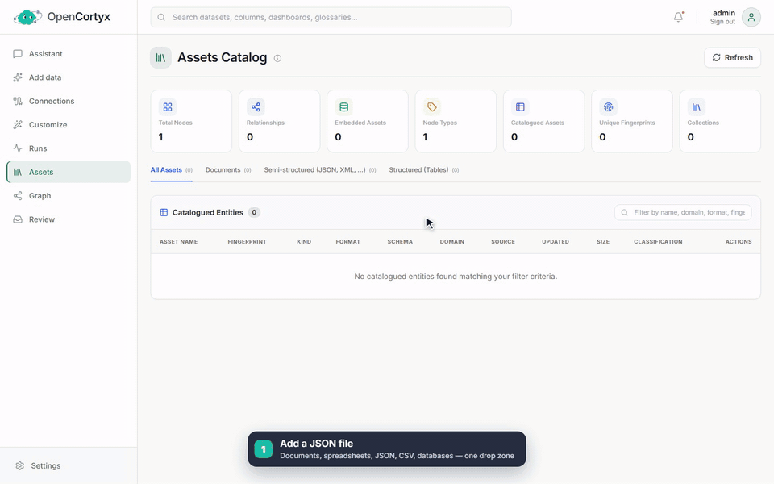
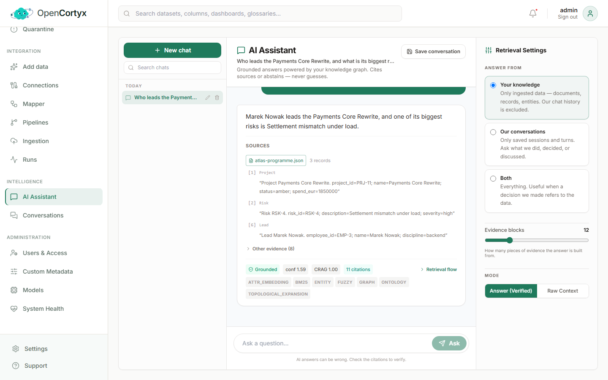
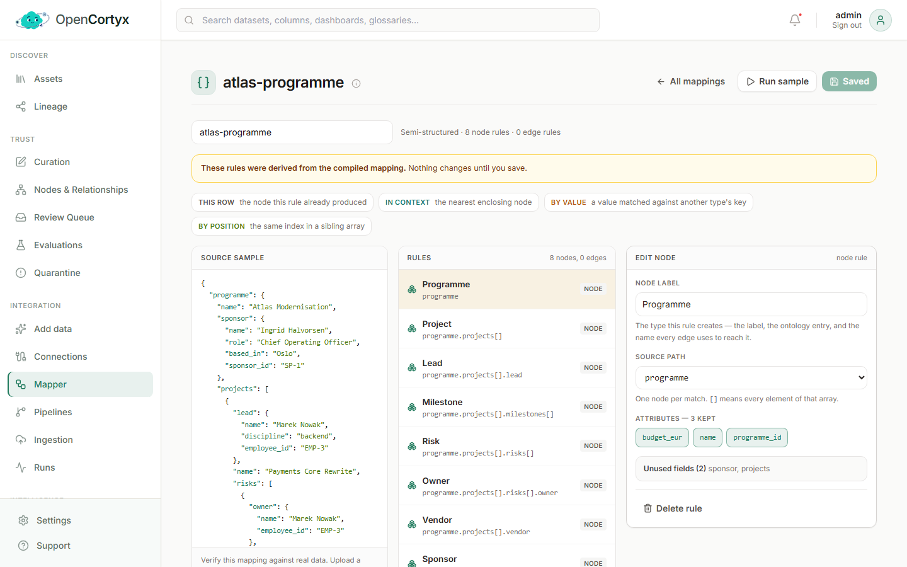
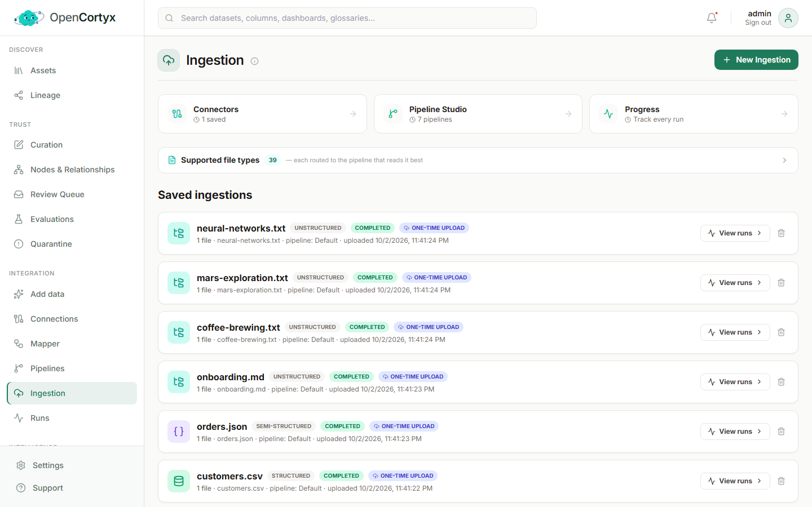
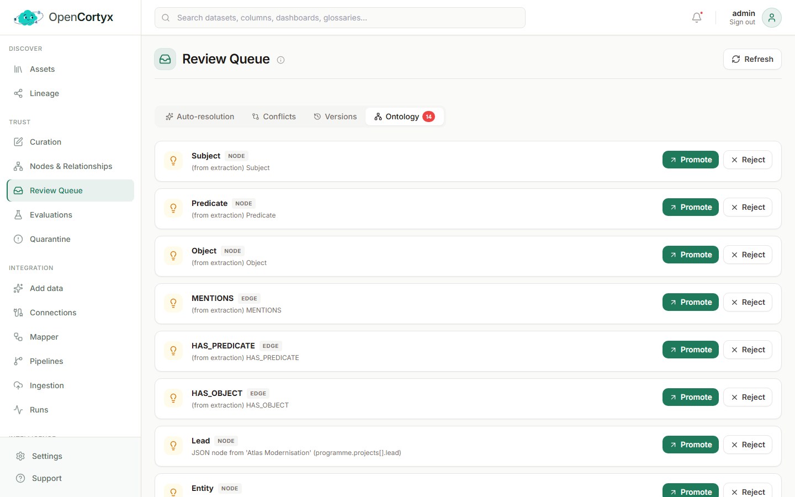
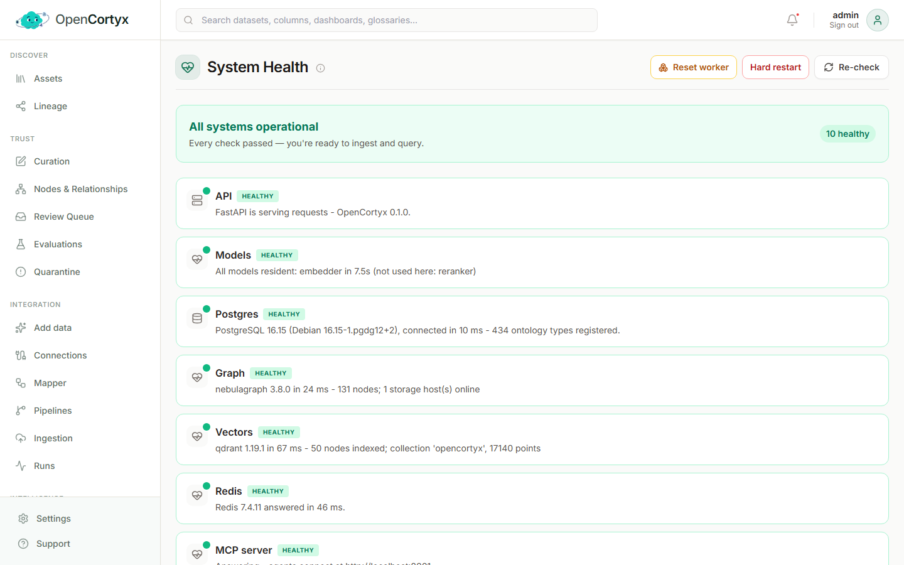
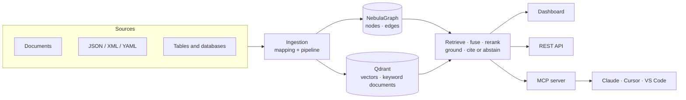

<div align="center">

<a href="https://www.opencortyx.com">
  
</a>


### The Knowledge Layer for AI

Connect your data, documents, systems, and relationships into one intelligent knowledge layer
that gives AI agents the context they need to understand, reason, and act.

Every answer shows exactly where it came from, or says "I don't know." Self-hosted, so your data
never leaves your machine.

[Website](https://www.opencortyx.com) ·
[Documentation](docs/README.md) ·
[Install](docs/installation/README.md) ·
[How it works](docs/how-it-works.md) ·
[Discord](https://discord.gg/bGs5jnvxK)

[](https://github.com/opencortyx/OpenCortyx/actions/workflows/ci.yml)
[](https://github.com/opencortyx/OpenCortyx/releases)
[](#status)
[](LICENSE)
[](https://www.opencortyx.com)
[](https://discord.gg/bGs5jnvxK)

<a href="docs/assets/demo/opencortyx-demo.mp4">
  
</a>

<sub>Add a JSON file → the Mapper drafts how to read it → ingest typed nodes and edges → open the graph in place → ask the AI Assistant, which answers with the records it rests on. Recorded end to end in the real product. <a href="docs/assets/demo/opencortyx-demo.mp4">Watch it in full quality (MP4)</a>.</sub>

</div>

## Three promises

- **One question across all your data.** SQL databases, data lakes (S3, GCS, Azure Data Lake),
  CSV, Parquet and Excel are read as tables, columns and rows. JSON, XML and YAML are mapped
  exactly as you define, not guessed by a model. PDFs, Word, Markdown, HTML and email are read and
  extracted. All of it is searched together.
- **Every answer shows its proof, or abstains.** Each piece of evidence names the asset it came
  from, in the chat, the API and MCP. When the evidence isn't there, OpenCortyx says so instead of
  guessing. Evaluations measure groundedness and abstention on your own questions.
- **Humans stay in charge.** Doubtful matches, conflicting values, new document versions and newly
  discovered types wait in the Review Queue until a person decides. Nothing is overwritten.

## How it's different

Memory tools such as Mem0, Supermemory and Graphiti remember what your users and agents *said*.
OpenCortyx answers from what your data *says*: tables, records and documents together, with
citations and human review. The two work well side by side.

> **License:** source-available. Free for individuals, education, research, non-commercial use
> and commercial teams of up to 5 people. [Details](#license)

## What it does

- **Structure it your way**: define node types, relationships and extractors in the dashboard;
  every derived fact keeps its source and confidence.
- **Retrieve with evidence**: hybrid search (vector, BM25, entity graph, multi-hop, structured
  catalogue) fused and reranked. An entity found in many assets lists them ranked for the
  question. Sources show only the records an answer rests on, grouped by file; the rest of what
  was retrieved stays one click away.
- **Browse the graph at any scale**: workspace → sources → tags → assets → what each asset
  contains, opened in place 100 at a time, so even a very large graph stays readable. The
  workspace carries your name or your organisation's, set in Settings.
- **Every record stays itself**: ids in your data are kept as attributes, never used to merge
  records; whether two records are the same thing is decided by the Resolution Engine, which keeps
  both values and flags conflicts for review instead of overwriting.
- **Serve agents**: a built-in MCP server gives Claude, Cursor, VS Code and other clients search,
  answers, memory and governed write-back.
- **Run anywhere**: NebulaGraph holds the graph, Qdrant its search surfaces, Postgres the control
  plane, and all three start with the stack. Use a local GPU model, a model already running on your
  machine (Ollama, LM Studio), or a hosted API.

## Install

The only requirement is [Docker](https://docs.docker.com/get-docker/) with at least 8 GB of memory
available to it and about 10 GB of free disk.

**macOS, Linux, WSL**

```bash
curl -fsSL https://raw.githubusercontent.com/opencortyx/OpenCortyx/main/install.sh | bash
```

**Windows (PowerShell)**

```powershell
irm https://raw.githubusercontent.com/opencortyx/OpenCortyx/main/install.ps1 | iex
```

The installer downloads the latest release, generates secrets, picks a model backend, starts the
stack and waits until it is healthy. Then open http://localhost:3000 and create your admin account.

| Environment | Guide |
|---|---|
| Windows 10 and 11 | [docs/installation/windows.md](docs/installation/windows.md) |
| macOS (Apple silicon and Intel) | [docs/installation/macos.md](docs/installation/macos.md) |
| Linux (Ubuntu, Debian, Fedora, ...) | [docs/installation/linux.md](docs/installation/linux.md) |
| Windows Subsystem for Linux | [docs/installation/wsl.md](docs/installation/wsl.md) |
| Production server with a domain and TLS | [docs/installation/server.md](docs/installation/server.md) |

**From a clone**

```bash
git clone https://github.com/opencortyx/OpenCortyx.git
cd OpenCortyx
bin/opencortyx up          # Windows: bin\opencortyx up
```

### Choosing a model

Models are chosen in the dashboard under **Models**, one default per role (generation, extraction,
utility, embedding, rerank). No `.env` setting is involved.

| Setup | Generation model on the Models page |
|---|---|
| NVIDIA GPU (local vLLM, started by `bin/opencortyx init` when detected) | The built-in rows: vLLM, `http://vllm:8000/v1` |
| Ollama or LM Studio on the same machine | OpenAI-compatible, `http://host.docker.internal:11434/v1`, Model ID from `ollama list` |
| OpenAI, Anthropic, Groq | The provider, its API key and a Model ID such as `gpt-4o-mini` |
| Azure, Together | OpenAI-compatible, the provider's Base URL and API key |

Embeddings run on CPU inside the stack, so no GPU is needed for them. The local vLLM server needs
an NVIDIA GPU and about 40 GB more disk. See [docs/models.md](docs/models.md).

## Features

<table>
<tr>
<td colspan="2" valign="top">

**[AI Assistant](docs/features/intelligence.md)**: answers grounded in your data, with the records
each answer rests on grouped by the file they came from, and everything else retrieved one click
away under "Other evidence".


</td>
</tr>
<tr>
<td width="50%" valign="top">

**[Assets](docs/features/discover.md#assets)**: every ingested document, record set and table, with
its format, size, content fingerprint and everything derived from it.


</td>
<td width="50%" valign="top">

**[Lineage](docs/features/discover.md#lineage)**: the knowledge graph as a tree you open in place:
workspace, sources, tags, assets, and the entities and facts extracted from each.


</td>
</tr>
<tr>
<td valign="top">

**[Mapper](docs/features/integration.md#mapper)**: declare the nodes, edges and attributes a
source becomes; one builder for JSON, tables and documents.


</td>
<td valign="top">

**[Ingestion](docs/features/integration.md#ingestion)**: re-runnable ingestions from databases,
object storage and local folders, on demand, on a schedule or in real time.


</td>
</tr>
<tr>
<td valign="top">

**[Review Queue](docs/features/trust.md#review-queue)**: decide on doubtful matches, conflicting
values, new document versions and newly discovered types. Nothing changes until you do.


</td>
<td valign="top">

**[System Health](docs/features/administration.md#system-health)**: a live check of the API,
database, worker and models, with suggested fixes.


</td>
</tr>
</table>

| Area | What you get | Guide |
|---|---|---|
| Discover | Assets, Lineage | [discover.md](docs/features/discover.md) |
| Trust | Curation, Nodes & Relationships, Review Queue, Evaluations, Quarantine | [trust.md](docs/features/trust.md) |
| Integration | Add data, Connections, Ingestion, Mapper, Pipelines, Runs | [integration.md](docs/features/integration.md) |
| Intelligence | AI Assistant, Conversations, MCP tools | [intelligence.md](docs/features/intelligence.md) |
| Administration | Users & Access, Custom Metadata, Models, System Health, Settings | [administration.md](docs/features/administration.md) |

## How it works



Sources are routed by shape: documents are chunked and extracted by a model, records are walked
into nodes deterministically, and tables are catalogued as tables, columns and rows. Every node
and edge lands in NebulaGraph and every searchable surface in Qdrant, while Postgres keeps the
control plane: collections, pipelines, mappings, runs and the ontology. A question runs several
retrievers in parallel, fuses and reranks their results, and answers only from evidence it can cite. The full walkthrough, with diagrams of
the data model and the answer pipeline, is in [docs/how-it-works.md](docs/how-it-works.md).

| Layer | Technology |
|---|---|
| Web | Next.js 15, React 19, TypeScript, Tailwind CSS |
| API and workers | Python 3.11, FastAPI, SQLAlchemy 2, Celery |
| Storage | NebulaGraph (graph) · Qdrant (vectors + BM25) · PostgreSQL 16 (control plane) |
| Queue | Redis |
| Models | vLLM or any OpenAI-compatible endpoint; fastembed for embeddings |

## Usage

```text
bin/opencortyx up                 start (pull release images or build) and wait until healthy
bin/opencortyx up --build         rebuild images from your checkout
bin/opencortyx status             service status
bin/opencortyx doctor             check Docker, database, model server and embeddings
bin/opencortyx logs [service]     follow logs
bin/opencortyx connect claude KEY register the MCP server with Claude Code
bin/opencortyx backup | restore   back up or restore every store (database, graph, vectors)
bin/opencortyx update             move to the latest release and restart
bin/opencortyx version            print the installed version
bin/opencortyx down               stop (data is kept)
bin/opencortyx reset              delete all data
```

| | URL |
|---|---|
| Dashboard | http://localhost:3000 |
| API docs | http://localhost:8000/docs |
| MCP endpoint | http://localhost:8001/mcp |

## Connect an AI client (MCP)

Create an API key in the dashboard under **Users & Access**, then:

```bash
bin/opencortyx connect claude ax_your_key     # Claude Code
bin/opencortyx connect cursor ax_your_key     # prints the config for ~/.cursor/mcp.json
```

Or add it to any MCP client by hand:

```json
{
  "mcpServers": {
    "opencortyx": {
      "type": "http",
      "url": "http://localhost:8001/mcp",
      "headers": { "X-API-Key": "ax_your_key" }
    }
  }
}
```

Tools include `opencortyx_search`, `opencortyx_answer`, `opencortyx_graph_query`,
`opencortyx_remember`, `opencortyx_recall` and `opencortyx_propose`. See the
[full tool list](docs/features/intelligence.md#mcp-tools).

## Running in production

- **Network:** services listen on `127.0.0.1`. Put a TLS reverse proxy in front of the dashboard
  (3000), API (8000) and MCP server (8001), set `PUBLIC_WEB_URL` and `PUBLIC_API_URL`, and add the
  proxy hostname to `MCP_ALLOWED_HOSTS`. Step by step: [docs/installation/server.md](docs/installation/server.md).
- **Secrets:** `bin/opencortyx init` generates unique secrets; the API refuses to start without
  `JWT_SECRET`. Keep `.env` out of version control.
- **Backups:** schedule `bin/opencortyx backup` and test restores. See [docs/BACKUP-RESTORE.md](docs/BACKUP-RESTORE.md).
- **Updates:** `bin/opencortyx update`; migrations run automatically before the API starts.
- **Resources:** every container has a memory limit and rotated logs. See [docs/memory-budget.md](docs/memory-budget.md).
- **Health:** `bin/opencortyx doctor`, `GET /health`, and Prometheus metrics at `GET /metrics`.

See [SECURITY.md](SECURITY.md) for reporting vulnerabilities and hardening notes.

## Repository layout

```
apps/api        FastAPI service, Celery workers, Alembic migrations, tests
apps/web        Next.js dashboard and its Playwright end-to-end tests
apps/mcp        MCP server
bin/            opencortyx command (bash and PowerShell)
docker/         container support files
docs/           user and contributor documentation
examples/data   sample documents and datasets
scripts/        check-memory-budget.py (see docs/memory-budget.md)
compose.yaml    the stack (compose.dev.yaml adds live reload for development)
```

## Status

OpenCortyx is in beta. The core loop (ingest, extract, retrieve, answer, MCP) works end to end.
Extraction quality depends on the model you run; small local models produce fewer structured
entities than larger ones. Not built yet: PII masking, SSO/SCIM, text-to-SQL, change-data-capture,
and image or audio ingestion. See the [roadmap](docs/CONTEXT-OS-ROADMAP.md).

## Community and contributing

- Questions and ideas: [Discord](https://discord.gg/bGs5jnvxK)
- Bugs and feature requests: [GitHub issues](https://github.com/opencortyx/OpenCortyx/issues)
- Development setup, tests and conventions: [CONTRIBUTING.md](CONTRIBUTING.md)
- Security issues: [SECURITY.md](SECURITY.md)

## License

OpenCortyx is source-available under the [OpenCortyx Community License](LICENSE): free for
individuals, education, research, non-commercial use, and commercial teams of up to 5 people. Larger
commercial use requires a commercial license. The LICENSE file is the governing text.
