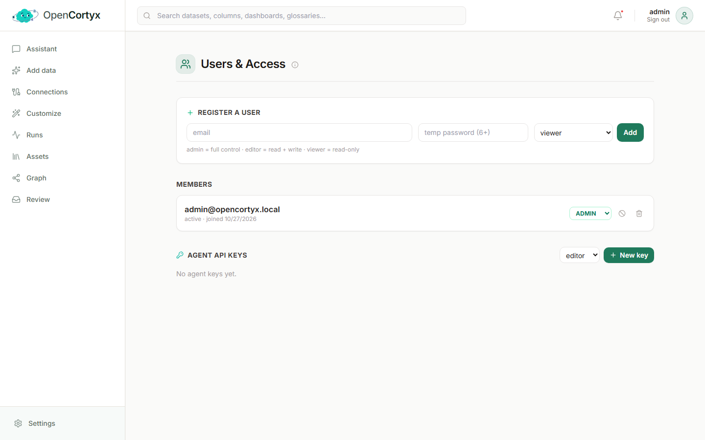
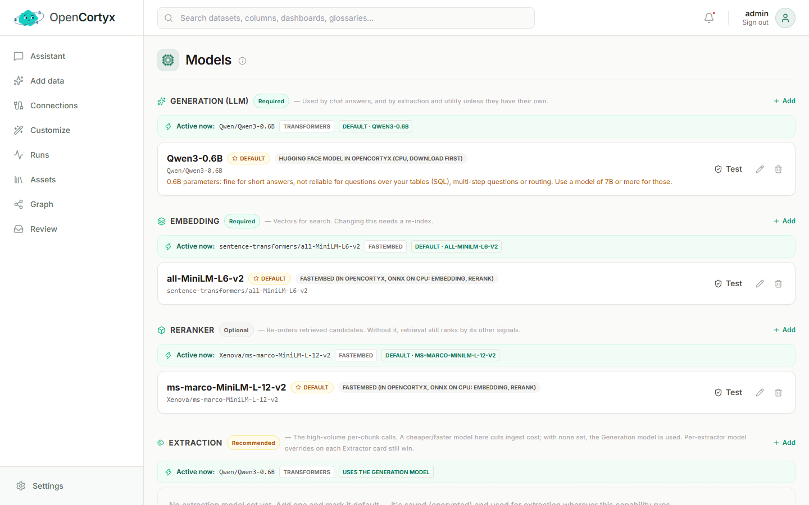
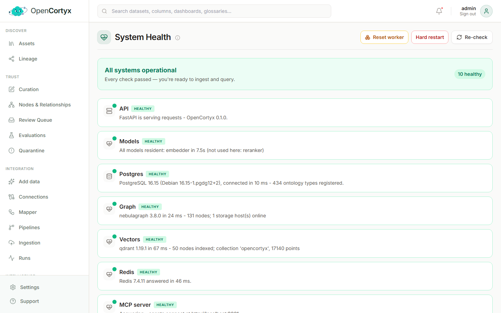
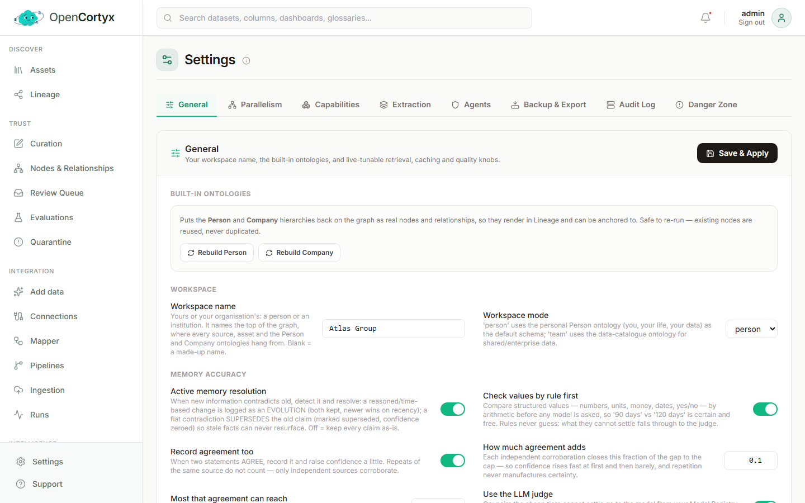

# Administration

Manage people, models and the running system. You find these pages under
**Administration** in the dashboard menu. Most of them need the `admin` role.

## Users & Access

Decide who can use the workspace and what they can do, and create keys for agents and scripts.

### How to use it

**Add a person:**

1. Under **Register a user**, type their email and a temporary password of at least 6 characters.
2. Pick a role and press **Add**. Share the password with them and ask them to change it.
3. To change someone's role later, use the role menu on their row under **Members**. The other
   icons disable or delete the account.

| Role | Can |
|---|---|
| `viewer` | read everything in the workspace and ask questions, but not change data |
| `editor` | everything a viewer can, plus ingest, curate, review and edit |
| `admin` | everything an editor can, plus manage users, API keys, models and settings |

**Decide who reads which collection:**

A collection is a group of files (pick one in Add data, under Custom > **Collection**). A policy gives
a **group** read access to a collection, up to a sensitivity.

1. Give people groups: type a group (for example `finance`) under their email under **Members**. An
   API key gets its groups when it is created. A person's role is always one of their groups too.
2. Under **Who reads which collection**, pick a group, a collection (or **Every collection**) and
   **Up to** (`normal` is the usual; `confidential` also shows personal-data columns), then
   **Add policy**.
3. Use **What does this person or group read?** to check before relying on it.

The first policy turns access control on for the whole workspace: from then on everyone reads only
the collections a policy gives their groups, plus files in no collection, which stay workspace-wide.
Admins read every collection. Removing the last policy turns it off. The rule applies to every
read - answers, search, the graph, browsing and the Data tab - and something a person may not read
is "not found", never "forbidden".

**Create a key for an agent or script:**

1. Under **Agent API keys**, pick the role the key acts with.
2. Press **New key** and copy it right away. It is shown only once.
3. Send it in the `X-API-Key` header to the REST API, or give it to an MCP client
   (see [MCP tools](intelligence.md#mcp-tools)).

### Good to know

- The first visit to a new installation creates the admin account. There is no default password.
- Forgot the admin password? On the machine running OpenCortyx, run
  `opencortyx reset-password <email>` (Windows: `bin\opencortyx.ps1 reset-password <email>`). It asks
  for the new password twice, hidden, and also re-enables the account if it was disabled.
- Revoke a key you no longer use. Anything using it stops working at once.
- Policies and groups take effect within 30 seconds on every server process.

## Cost & usage

Settings > **Cost & usage** shows what the models cost: this month against the budget, by use
(answers, each extractor, summaries, the answer checks), by model, and for each ingest run the cost
per 1,000 records. "Measured, not estimated" says how much of it the provider or the local tokenizer
counted; the rest is estimated at four characters a token and marked as such.

- Set a **Monthly budget** in paid tokens and, if you want, **Stop paid calls at the budget**. Free
  models (the built-in one, your own server) are never stopped. A run that reads files with a paid
  model pauses at the budget, keeping what it has read, and can be resumed.
- Set each paid model's price on the Models page; costs are its tokens times its price.
- When you choose extractors in Add data, each shows what it cost per 1,000 records on its last calls.
  Run a preview of a new extractor once to measure it.
- Extraction answers are cached: reading an unchanged record again costs nothing. **Clear cache**
  after changing a model in place.

## Data deletion

Settings > **Data deletion** (admins) forgets a person, a company or any record, everywhere.

1. Type the name and pick the record.
2. Read what would go: its records (and a merged record of them), records linked only to it, the
   chats and labels that name it, and the **documents that also mention it** - tick the ones to forget
   whole; the others are kept and still mention the name.
3. Type the name again to confirm, and press **Forget everywhere**.

Each deletion is listed under **Deletion history** with one line per store and a **proof**: what a
search of every store found afterwards. One that did not finish says what is left and has **Retry**.
What was forgotten is kept from coming back - it is refused from a synced folder, an upload or a
backup restore - and only a hash of it is stored. **Allow again** lifts that.

Deleting a file (Assets) removes it from every store the same way: its records, search points, table
rows (the table history is cleaned at once), evidence, cached answers, the stored upload, runs, and
chat citations; a merged record it was part of is rebuilt without it. An admin can tick **Also keep it
from coming back** to forget it. Leave it off to upload a corrected version later. Data read from a
customer's own database or lake is never written to: OpenCortyx forgets what it read, and the source
still holds it.

## Models

Choose which models OpenCortyx uses for each job.

### How to use it

1. Open **Settings > Models**. The **Model server** box at the top lists what each connected server is serving.
2. Each role shows the model it uses now, under **Active now**, or **Not connected**:

   | Role | Used for |
   |---|---|
   | Generation | answers and planning (required for the AI Assistant) |
   | Embedding | vectors for semantic search. `fastembed` runs on CPU inside the stack (required) |
   | Reranker | putting retrieved passages in order of relevance |
   | Extraction | entity and relationship extraction during ingestion. Uses the generation model unless set |
   | Utility / Judge | the grounding checks behind abstention. Uses the generation model unless set |

3. Press **Add** next to a role and fill in the provider, Model ID, server address and key.
4. Press **Test** to check that it answers before you rely on it.
5. Tick **Make default** for the role. Changing the embedding model means re-indexing your data.

### Good to know

- A new workspace starts with a small built-in generation model (Qwen3-0.6B, on CPU). If a
  workspace's generation model is removed, the Assistant and extraction say that no generation
  model is connected until you add one.
- Providers: an OpenAI-compatible server (Ollama, LM Studio, vLLM, Together, Azure), OpenAI,
  Anthropic, Groq, Hugging Face Inference, and a Hugging Face model running in OpenCortyx for
  generation; fastembed for embeddings and reranking (sentence-transformers too, for reranking,
  when the image is built with it).
- A model that is not on this machine yet can be downloaded from the **Add** form, for any role:
  a text model into Ollama (fast, GPU) or into OpenCortyx itself (CPU, nothing to install), an
  embedder or reranker from fastembed. See
  [Models](../models.md#download-a-model-from-hugging-face).
- This page is the only place models are chosen. Nothing in `.env` selects one, and OpenCortyx
  does not start a model server. See [Models](../models.md).

## System Health

A live check of every part of the system, in plain language.

### How to use it

1. Open **Settings > System health**. The banner says whether everything is working.
2. Each part has its own card: the API, the models, Postgres, the graph (NebulaGraph), the vectors
   (Qdrant), Redis, the MCP server and the workers. Each one is **healthy**, a warning, or down,
   with an explanation and a suggested fix.
3. Press **Re-check** after you fix something.
4. If ingestion is stuck, press **Reset worker**. Use **Hard restart** only when that does not help.

From a terminal, `bin/opencortyx doctor` runs the same checks without the dashboard.

## Settings

Workspace-wide settings, organised in tabs.

### How to use it

1. Open **Settings** and pick a tab.
2. Change what you need. On the **General** tab, press **Save & Apply**. Changes take effect without
   a restart.

| Tab | What it controls |
|---|---|
| General | the **Workspace name** and **Workspace mode** (see below), the built-in Person and Company ontologies, and retrieval, caching and quality settings |
| Parallelism | how many retrievers run per question, and how many ingestions and extraction model calls run at the same time |
| Capabilities | optional modules, such as contradiction detection and versioning |
| Extraction | which extractors run, how they are combined into shared model calls and in what order, with an estimate of model calls per document |
| Agents | the connected MCP agents and what each may capture as memory |
| Backup & Export | export the workspace as JSON (with or without embeddings) and import it, merging or replacing. Connection secrets and API keys are never exported |
| Audit Log | who changed what, and when |
| Danger Zone | actions you cannot undo: clear the task queue (ingested data stays), or delete all data |

### Good to know

- The workspace name and mode belong to your workspace, not to the whole install. In **person** mode
  the workspace is you: the top of the graph is a **Person** node with your name. In **team** mode it
  is a team or organisation: the top is an **Organization** node with its name. Switching mode or
  renaming changes that node in place, so nothing attached to it is lost. Both are first asked for
  when the workspace is created.
- Leave the workspace name blank and the graph shows a made-up name.
- **Rebuild Person** and **Rebuild Company** put the built-in ontologies back on the graph after a
  reset. They are safe to press again: nothing is duplicated.
- For full database backups use `bin/opencortyx backup`. See
  [Backup and restore](../BACKUP-RESTORE.md).
