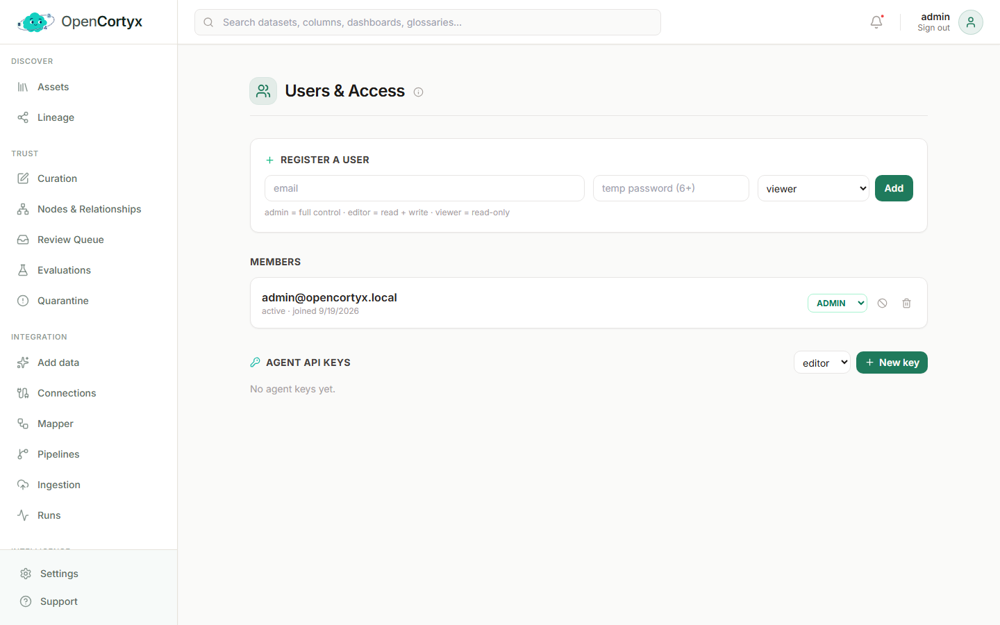
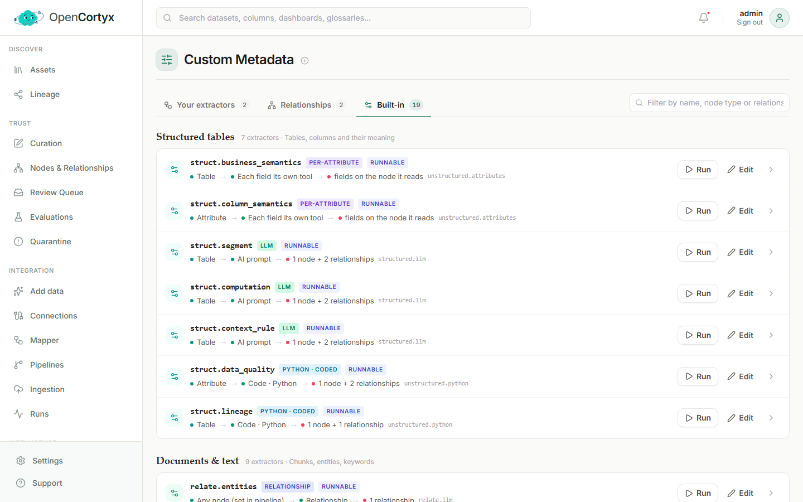
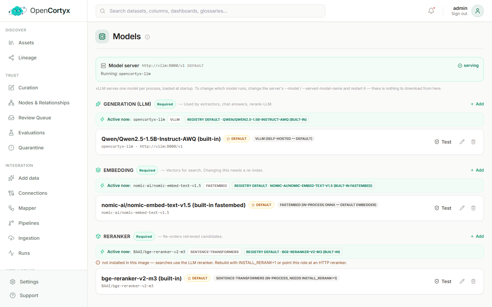
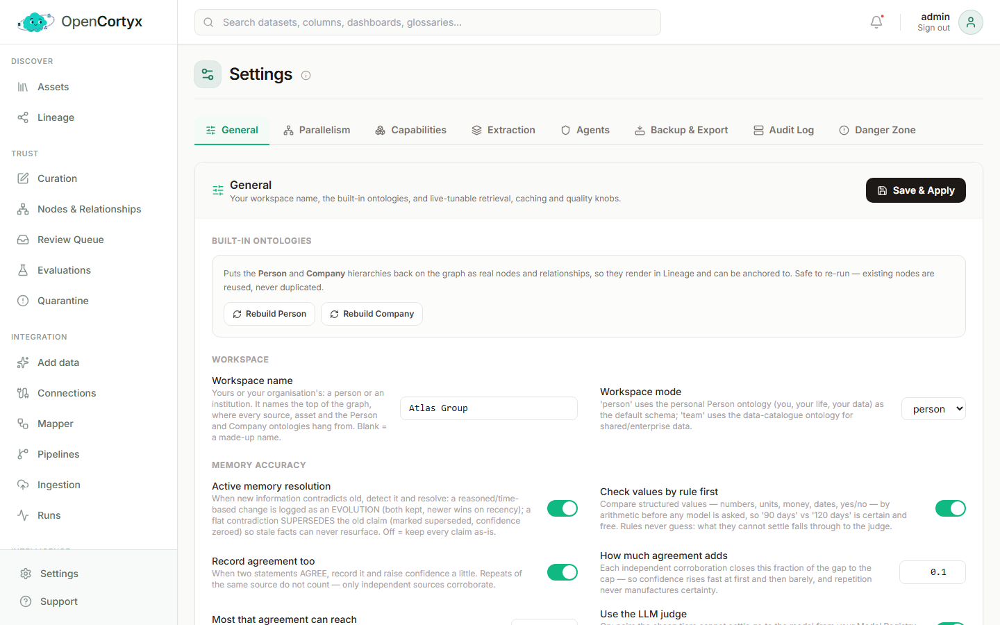

# Administration

Manage people, models, extractors and the running system. You find these pages under
**Administration** in the dashboard menu. Most of them need the `admin` role.

## Users & Access

Decide who can use the workspace and what they can do, and create keys for agents and scripts.

### How to use it

**Add a person:**

1. Under **Register a user**, type their email and a temporary password of at least 6 characters.
2. Pick a role and press **Add**. Share the password with them and ask them to change it.
3. To change someone's role later, use the role menu on their row under **Members**. The other
   icons disable or delete the account.

| Role | Can |
|---|---|
| `viewer` | read everything in the workspace and ask questions, but not change data |
| `editor` | everything a viewer can, plus ingest, curate, review and edit |
| `admin` | everything an editor can, plus manage users, API keys, models and settings |

**Create a key for an agent or script:**

1. Under **Agent API keys**, pick the role the key acts with.
2. Press **New key** and copy it right away. It is shown only once.
3. Send it in the `X-API-Key` header to the REST API, or give it to an MCP client
   (see [MCP tools](intelligence.md#mcp-tools)).

### Good to know

- The first visit to a new installation creates the admin account. There is no default password.
- Revoke a key you no longer use. Anything using it stops working at once.

## Custom Metadata

Extractors turn what you already have into new nodes, relationships and attributes, for example
the people and organisations named in a document. You define them here, without code.

### How to use it

1. Open **Custom Metadata**. The three tabs are:
   - **Your extractors**: the ones you created.
   - **Relationships**: rules that connect nodes into typed relationships.
   - **Built-in**: the extractors that ship with OpenCortyx, grouped by what they read (structured
     tables, documents and text, and more).
2. To create one, press **New extractor** and say:
   - which node types it reads (for example `Chunk`),
   - how it works (an AI prompt, code, or a rule),
   - what it produces: the node types, relationships and attributes.
3. Preview it on a few sample nodes, then save.
4. Press **Run** on any extractor to run it over the workspace now, or add it as a step in a
   [pipeline](integration.md#pipelines) so it runs on every new asset.
5. Press **Edit** to change an extractor, or the bin to delete one of yours.

### Resolution settings

An extractor's **Resolution** section says when two nodes it creates are the same thing: the fields
they are **identified by**, the **Scorer** (exact or similar), and when a match is applied
automatically or sent for review. It is the same setting, per node type, that you find on
[Nodes & Relationships](trust.md#match-the-same-record-across-files-resolution), which works for
every type, including the record types of a JSON mapping.

## Models

Choose which models OpenCortyx uses for each job.

### How to use it

1. Open **Models**. The box at the top shows the local model server and the model it is serving.
2. Each role lists the model it uses now, under **Active now**:

   | Role | Used for |
   |---|---|
   | Generation | answers, planning, and extraction when no extraction model is set (required) |
   | Embedding | vectors for semantic search. `fastembed` runs on CPU inside the stack by default (required) |
   | Reranker | putting retrieved passages in order of relevance. Without one, the generation model does it |
   | Extraction | entity and relationship extraction during ingestion |
   | Utility / Judge | the grounding checks behind abstention. Give it a capable model |

3. To use another model, press **Add** next to a role and fill in the provider, model ID, endpoint
   and key.
4. Press **Test** to check that it answers before you rely on it.
5. Make it the default for the role. Changing the embedding model means re-indexing your data.

### Good to know

- Providers include vLLM, OpenAI, Anthropic, Groq, Hugging Face Inference and any
  OpenAI-compatible endpoint (Ollama, LM Studio, Together, Azure) for generation; fastembed and Text
  Embeddings Inference for embeddings; Cohere, Jina, Infinity and sentence-transformers for
  reranking.
- The local vLLM server serves one model, chosen when it starts. To change it, change the server's
  `--model` and restart it. There is nothing to download from this page.
- The first configuration comes from `.env`. See [Models](../models.md).

## System Health

A live check of every part of the system, in plain language.

### How to use it

1. Open **System Health**. The banner says whether everything is working.
2. Each part has its own card: the API, the models, Postgres, the graph (NebulaGraph), the vectors
   (Qdrant), Redis, the MCP server and the workers. Each one is **healthy**, a warning, or down,
   with an explanation and a suggested fix.
3. Press **Re-check** after you fix something.
4. If ingestion is stuck, press **Reset worker**. Use **Hard restart** only when that does not help.

From a terminal, `bin/opencortyx doctor` runs the same checks without the dashboard.

## Settings

Workspace-wide settings, organised in tabs.

### How to use it

1. Open **Settings** and pick a tab.
2. Change what you need. On the **General** tab, press **Save & Apply**. Changes take effect without
   a restart.

| Tab | What it controls |
|---|---|
| General | the **Workspace name** and **Workspace mode** (see below), the built-in Person and Company ontologies, and retrieval, caching and quality settings |
| Parallelism | how many retrievers run per question, and how many ingestions and extraction model calls run at the same time |
| Capabilities | optional modules, such as contradiction detection and versioning |
| Extraction | which extractors run, how they are combined into shared model calls and in what order, with an estimate of model calls per document |
| Agents | the connected MCP agents and what each may capture as memory |
| Backup & Export | export the workspace as JSON (with or without embeddings) and import it, merging or replacing. Connection secrets and API keys are never exported |
| Audit Log | who changed what, and when |
| Danger Zone | actions you cannot undo: clear the task queue (ingested data stays), or delete all data |

### Good to know

- The workspace name and mode belong to your workspace, not to the whole install. In **person** mode
  the workspace is you: the top of the graph is a **Person** node with your name. In **team** mode it
  is a team or organisation: the top is an **Organization** node with its name. Switching mode or
  renaming changes that node in place, so nothing attached to it is lost. Both are first asked for
  when the workspace is created.
- Leave the workspace name blank and the graph shows a made-up name.
- **Rebuild Person** and **Rebuild Company** put the built-in ontologies back on the graph after a
  reset. They are safe to press again: nothing is duplicated.
- For full database backups use `bin/opencortyx backup`. See
  [Backup and restore](../BACKUP-RESTORE.md).
