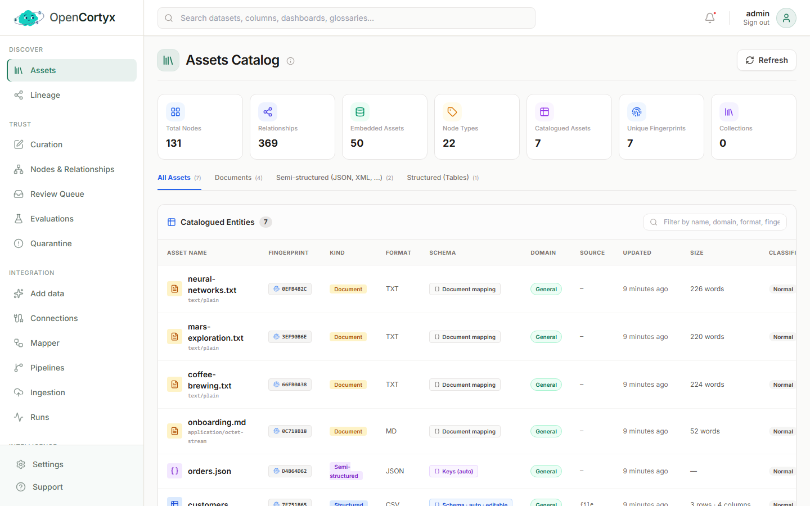
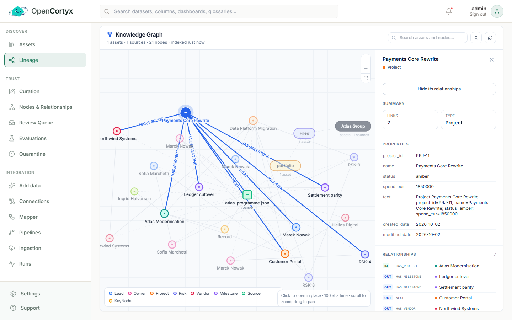

# Discover

See what is in your workspace and how it connects. You find these pages under **Discover** in the
dashboard menu.

## Assets

An asset is one thing you added: a document, a JSON or XML file, a spreadsheet, or a table from a
database. The Assets page lists every one of them, with what was derived from each.

### How to use it

1. Open **Assets** from the menu. The cards at the top count your nodes, relationships, node types
   and assets.
2. Pick a tab to narrow the list: **Documents**, **Semi-structured (JSON, XML, ...)** or
   **Structured (Tables)**.
3. Type in the filter box to search by name, domain, format or fingerprint.
4. Click an asset to open it. You see the nodes, attributes and relationships it produced, and
   where each one came from. You can also edit its tags there.
5. To remove an asset, delete it from its row or from its page. Everything derived from it goes too:
   nodes, relationships and search entries.

### Good to know

- Each row shows the kind and format, the mapping that read it, its domain, where it came from, when
  it last changed and its size (words for documents, rows and columns for tables).
- The **fingerprint** is a 64-bit summary of the content. Similar content gets a similar
  fingerprint, which is how OpenCortyx spots a new version of a document you already have. The match
  then waits in the [Review Queue](trust.md#review-queue).
- Press **Refresh** after a large ingest to update the counts.

### Schema signatures

When a source is ingested, OpenCortyx records the *shape* of its data, never its file name:

| Kind | Signature |
|---|---|
| Semi-structured (JSON, XML, YAML, ...) | the set of key paths in a record |
| Structured (CSV, Parquet, database tables, ...) | the column names |
| Documents | the source type and file format |

A new source with the same signature as a saved [mapping](integration.md#mapper) is read through
that mapping. So `customers.csv`, `customers_2026.csv` and the database table `dbo.customers` are
all recognised as the same shape and read the same way.

## Lineage

Lineage is your knowledge graph, drawn as a tree you open one level at a time. It stays fast and
readable however big the graph gets.

### How to use it

1. Open **Lineage**. You see one item: your workspace — you (a Person) or your team (an
   Organization), named after the **Workspace name** in [Settings](administration.md#settings).
2. Click the workspace to open its sources: **Files**, your collections, and any connected
   databases.
3. Click a source to see its tags, then a tag to see the assets filed under it.
4. Click an asset to see what it contains: records, sections, tables and columns, plus the entities
   and facts extracted from it.
5. Click any node to show its relationships. The side panel lists its type, properties and every
   relationship, with the node at the other end.
6. Click an open item again to close it.
7. To find something, type in **Search assets and nodes...** and press Enter. Matches are
   highlighted and the levels that lead to them open for you.

### Good to know

- Nothing on screen moves when you open something. New items appear around the one you clicked.
- Each click loads 100 items. A **+N more** item loads the next 100.
- A node with more than 1,000 relationships shows them grouped by type first, so you pick which
  group to open.
- A file you add without tags is filed under its extension (for example `json`). Add tags when you
  upload, or later on the asset's page.
- Things no asset leads to, such as nodes you created by hand or the built-in Person and Company
  templates, appear as extra items next to the workspace. Nothing is hidden.
- Use the zoom buttons or your mouse wheel to zoom, and drag to pan. The reset button fits the
  graph back on screen.

Agents can explore the same graph with the `opencortyx_graph_query` and `opencortyx_search_nodes`
[MCP tools](intelligence.md#mcp-tools), and programs can use the REST API
(see http://localhost:8000/docs).
