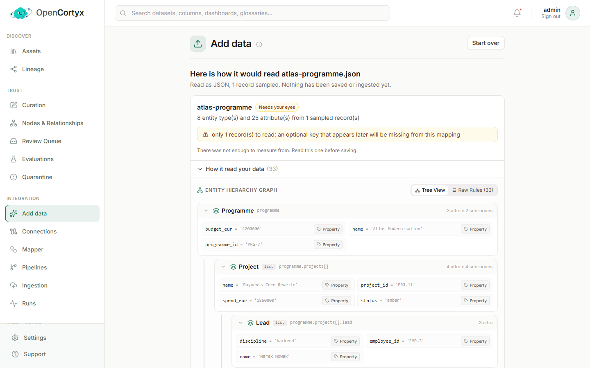
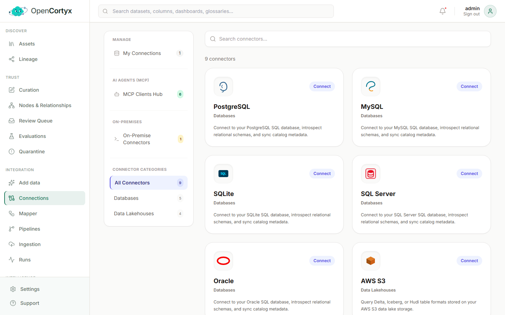
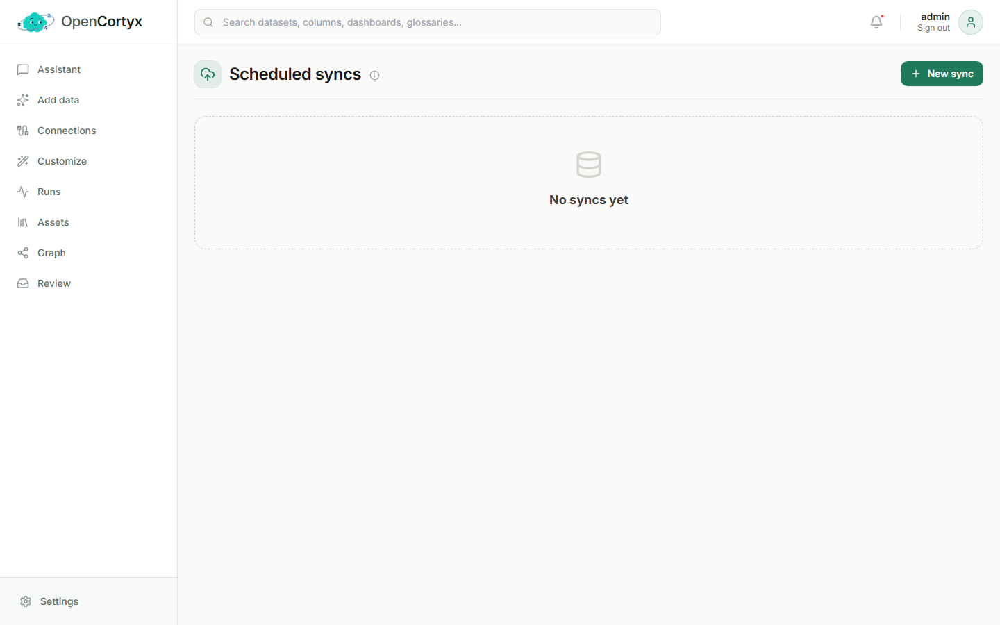
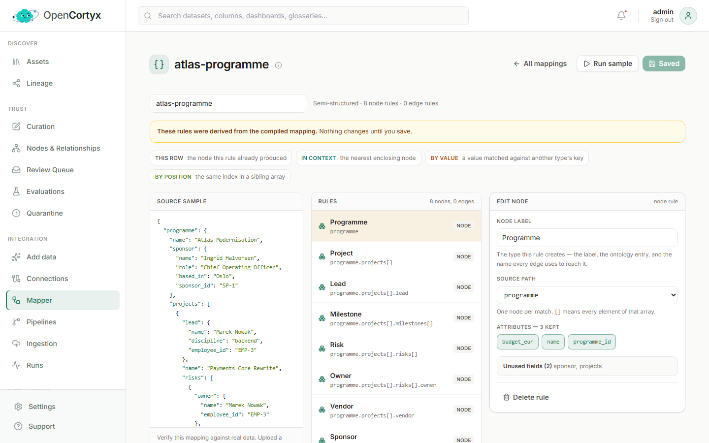
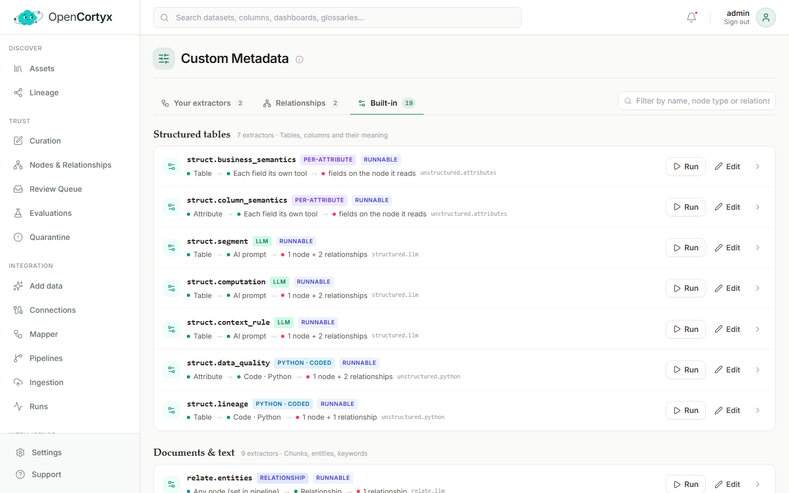
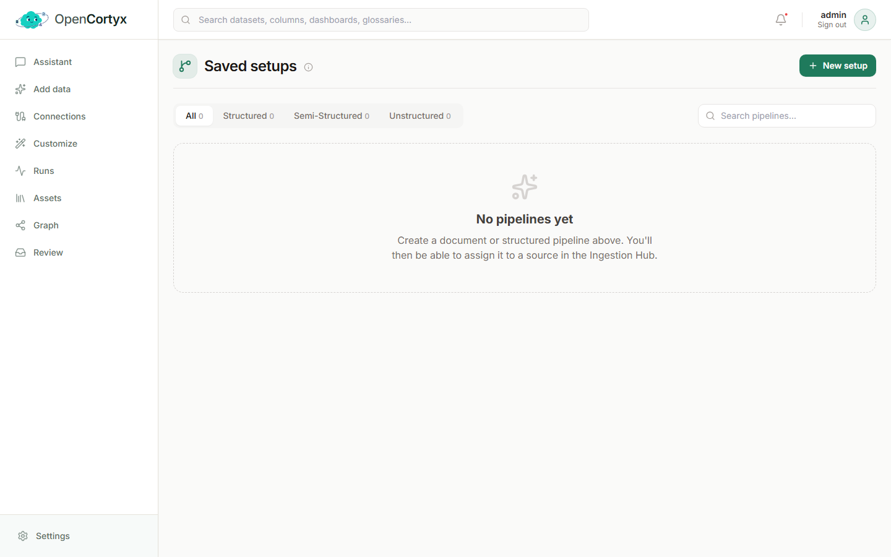
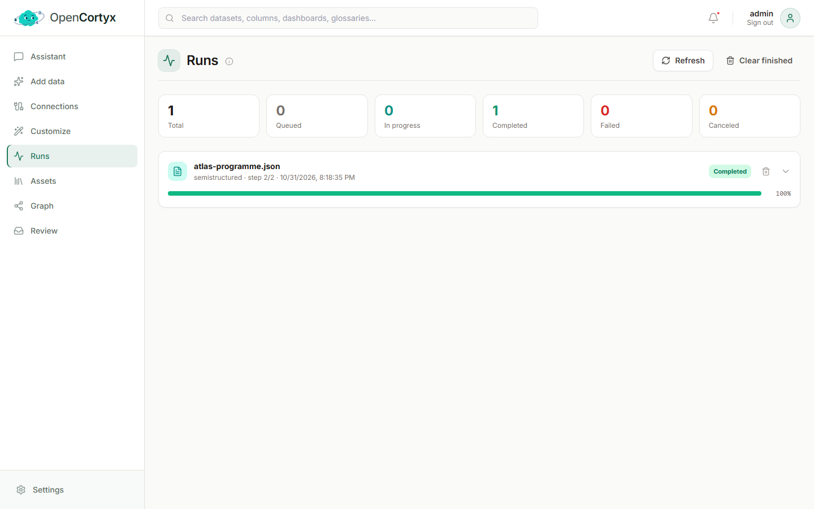

# Integration

Bring data in and decide what it becomes. **Add data**, **Connections** and the **Mapper** are in
the sidebar; Extractors, Saved setups (pipelines) and Scheduled syncs (ingestions) are under
**Customize**, and **Runs** has the sidebar entry of its own.

If you only want to add a file, start with [Add data](#add-data), then check what was found in it in
the [Mapper](#mapper). The other pages are for data you add again and again: saved connections,
scheduled ingestions, and the pipelines that read them.

## Add data

Add data is the quickest way in. Drop a file, choose what the graph gets from it, and press **Add**.
Or drop several files at once and add them together.

### How to use it

1. Open **Add data** and drop a file on the page, or click to choose one. Documents, spreadsheets,
   JSON and CSV all work. OpenCortyx works out which kind it is.
2. Under **Knowledge graph**, choose what the graph gets. The data itself is always kept, read
   with SQL and searchable, whichever you pick:
   - **Structure only** (tables, JSON): the columns or keys, their types and the links between
     files, with a description of each column when a model is on. For documents this option is
     **Summary only**: a summary, when AI summaries are on.
   - **Extract knowledge** (tables, JSON): OpenCortyx looks at each column's values and picks the
     ones that carry knowledge: the identifier, the name, text and dates. Each record becomes one
     node of its kind (Customer, Account, Project, Risk…) with those fields, and records that
     refer to each other are linked. Records nested inside others are found too: a project's risks
     inside a programme file become Risks linked to their Project. Change any of it later in the
     [Mapper](#mapper).
   - **Add the whole data**: every row, key and value, or every heading, paragraph and table, as
     nodes. It already holds every record, so it is never combined with Extract knowledge. Large
     files make large graphs.
3. Open **Custom** only if you want more. There you can add **Tags** (the graph groups assets by
   tag), choose a [pipeline](#pipelines) per kind of file and
   [extractors](#custom-extractors) to run over the file once it is in. Nothing has to be mapped
   before an upload: detection reads the file, and you correct what it found in the [Mapper](#mapper). Each extractor can be given
   the columns or keys (tables, JSON) or the sections (documents) it should read; leave it empty and
   it reads all of it.
4. Press **Add** and wait for the result card. It lists what was created, for example *Found 1
   Programme, 3 Projects, 3 Risks*. Detection runs once the file is in, and what it found appears in
   the [Mapper](#mapper) a minute or two later.

### Several files at once

Select or drop more than one file. The page lists them, with the same **Knowledge graph** choice
and, under **Custom**, a pipeline for each kind of file in the list. Press **Add N files**: each file
is ingested with the pipeline chosen for its kind, or the default one for its file type, and its
status shows in the list. Every file becomes its own run under [Runs](#runs).

### Good to know

- Nothing is saved or ingested until you press **Add**.
- Fields named `id` or ending in `_id` are kept as ordinary attributes. Each record gets its own
  node, so two files that share an id never overwrite each other. To link records that are the same
  thing, set [Resolution](trust.md#match-the-same-record-across-files-resolution) for their type.
- Adding the exact same file twice is skipped. If its knowledge went missing, the result card
  offers to read it again.

## Connections

A connection is a saved data source: a database, cloud storage, or a folder on the server.
[Ingestions](#ingestion) read from connections.

| Kind | Sources |
|---|---|
| Databases | PostgreSQL, MySQL, Microsoft SQL Server, Oracle, SQLite |
| Object storage | Amazon S3, Google Cloud Storage, Azure Data Lake Storage |
| Local files | a folder on the host, made available with `OPENCORTYX_FILES_ROOT` in `.env` |

### How to use it

1. Open **Connections**. The catalogue lists every connector. Use **Databases** or **Data
   Lakehouses** on the left to narrow it, or search.
2. Press **Connect** on the one you need.
3. Fill in the details. For the credentials, choose where they come from:
   - **Form**: type them in. They are encrypted before they are stored.
   - **Environment variable**: name a variable the server already has.
   - **Azure Key Vault**: read them from a vault, with a managed identity or a service principal.
4. Press **Test Connection**. When it works you can browse the tables or folders it can see.
5. Save. The connection appears under **My Connections**, ready for an ingestion.

### Good to know

- Secrets are never stored in plain text and never included in exports.
- **MCP Clients Hub** lists the AI agents you can connect over MCP. See
  [MCP tools](intelligence.md#mcp-tools).
- **On-Premise Connectors** read files on machines inside your network.

## Ingestion

An ingestion is a saved job you can run again: where to read from, what to read, and which
[pipeline](#pipelines) processes it.

### How to use it

1. Open **Customize > Scheduled syncs** (or **Connections > Scheduled syncs**), press **New sync**
   and give it a name. The short form asks only for the connection and what to read; **More
   options** shows everything below.
2. Choose the **Source**: a saved connection, or **Upload** to pick files (**Pick Files**) or a
   whole folder (**Pick Folder**).
3. Choose the **Classification**. **Auto-detect** sends each file to the pipeline that suits it.
   Use **Force Structured**, **Force Semi-Structured** or **Force Unstructured** to send everything
   one way.
4. Choose a **Pipeline**, or keep the default. With auto-detect you can pick one per kind:
   **Documents**, **Tables**, and **JSON and records**.
5. Choose how often it runs:
   - **On-demand**: only when you press run.
   - **Scheduled**: hourly, daily, weekly or monthly, at the time you set (UTC).
   - **Real-time**: on every sync tick, every 30 seconds by default (`SYNC_TICK_SECONDS`).
6. For folders, turn on **Watch folders** to pick up new files as they arrive, and **Keep folders
   as graph nodes** to keep the folder structure in the graph.
7. Press **Save**. The ingestion appears under **Saved ingestions**. Press **View runs** to follow
   it.

### Good to know

- Every run compares the source with the previous run and processes only what changed. The modes
  differ only in what starts a run.
- A file you add on the Add data page also appears here, as a one-time upload.
- **Supported file types** lists every format and the pipeline each one goes to.

### Supported formats

Each file is routed by its extension (or, without one, by its content) to the pipeline that suits
its shape:

| Route | Formats | Processing |
|---|---|---|
| Documents | `pdf` `docx` `doc` `pptx` `odt` `txt` `md` `markdown` `rst` `html` `htm` `eml` `msg` `log` `tex` `hl7` `csl` | parsed, chunked, embedded, then extracted by the model |
| Semi-structured | `json` `jsonl` `ndjson` `xml` `yaml` `yml` `toml` `rss` `atom` `geojson` `fhir` `har` | walked into nodes and edges, without model calls for the structure |
| Structured | `csv` `tsv` `parquet` `xlsx` `xls` `xlsm` `orc` `feather` `arrow` `avro` | loaded as tables, columns and rows |

The running server reports the same list at `GET /api/v2/ingest/formats`.

## Mapper

The Mapper is the one place to check and correct what a table or a JSON file means: the kinds of
thing in it, their names, what identifies each record, the attributes their graph nodes carry, and
how they connect. Detection fills it in after each upload; you only change what it got wrong.

### How to use it

1. Open **Mapper** and pick a file on the left. Each file shows its format (TABLE, JSON or DOC) and
   the kinds of thing found in it. A file still being read says so, and fills in on its own. A
   document has no fields to map: see [Documents](#documents-in-the-mapper) below.
2. **How it looks in the graph** draws the file's kinds as circles and their relationships as
   arrows. It changes as you edit. A kind read from another file that a relationship reaches is
   drawn dashed.
3. Under **What's in** the file, each kind is a card:
   - **Name**: click it to rename the kind. A rename is made once and reaches every file that has
     the kind.
   - **Identified by**: the field that identifies a record, offered only when the data shows it is
     filled and unique in every file. With an identifier the kind is a *thing* (the same id is the
     same node, whichever file it comes from); with **Nothing** each record is an *event*, such as a
     message or a transaction.
   - **Shown as**: the field a record is called by in the graph and in answers.
   - **Attributes**: the fields its graph nodes carry. The others stay in the data store, and
     questions still read them.
   - **In the graph** puts its records in the knowledge graph; **Use this kind** off says it is not a
     kind of thing at all.
   - **Same thing across files** says when two records, from any files, are the same thing: see
     [Resolution](trust.md#match-the-same-record-across-files-resolution).
4. Under **How they connect**, each line is a relationship, such as `Order ─CUSTOMER▶ Customer`
   through `customer_id`. Rename it, or untick it to drop it. A name marked **auto** is taken from
   the kind it points to and follows that kind's rename. **Add a relationship** connects a kind to
   any kind with an identifier, through one of its fields, for links the data does not show on its
   own (a file too small to be sure, for example).
5. Press **Save**. Changes on several files are saved together, the graph is updated, and files of
   the same shape read later are read the same way. **Undo changes** drops them all.
6. **What extractors found in it**, at the bottom, lists the kinds of thing extractors found in the
   text of this file's records, with how many of each. **Run an extractor on this file** runs one
   over this file now.
7. **Found by extractors**, below the files, lists every kind extractors found, in all files, each
   with a switch: turn off a kind you do not want.

### Documents in the Mapper

A document is read by its layout: its title, section headings, paragraphs, list items and tables,
in reading order. Pick a document (DOC) to see:

- **How it looks in the graph**: the document and the kinds of thing extractors found mentioned in it.
- **How it was read**: how many of each element, its sections with how much each holds (a plain
  text file has none), and its first passages.
- **Long paragraphs**: a paragraph longer than the split size (800 characters unless you change it)
  is split at sentence ends into passages of at most that size, so each is found and cited on its
  own. Tables, code and headings are never split. Change the size and press **Save and read this
  document again**; the size applies to every document read from now on. The server keeps an
  uploaded file for a week (`UPLOAD_RETENTION_HOURS`); after that, add the file again to read it
  with a new size.
- **What extractors found in it**, and **Run an extractor on this file**.

### Good to know

- What you change is kept: detecting the file again never overwrites it. **Advanced** on the
  **What's in** section shows where in the file each kind is read from, and **Detect again** reads
  the data again and takes what detection finds now (earlier versions are kept).
- Documents are read by their layout and by extractors, not mapped: see
  [How a document is read](../how-it-works.md#how-a-document-is-read).
- Rule mappings, which shape the graph with node and edge rules written by hand, stay available
  with the full interface (`FULL_UI=1`, see
  [Troubleshooting](../installation/troubleshooting.md)).

## Custom Extractors

Extractors pull what you need out of documents and records: kinds of thing, their fields, and how
they connect. You define them here, without code (or with it, if you want to).

### How to use it

1. Open **Customize > Extractors**. **Yours** lists the extractors you made; **Built-in** the ones
   that ship with OpenCortyx, whose prompt, code or model you can tune and reset.
2. Press **New extractor**, or start from an example. One form, top to bottom:
   - **What it reads**: whatever it is given (attach it to any upload, sync or file: document
     passages, table rows and JSON records alike; optionally only some columns, keys, JSON paths or
     headings), the records of a type across every file, or nodes already in the graph.
   - **How it finds things**: the **Model**, a **Pattern** (regular expressions or a word list), or
     **Python**.
   - **What it creates**: kinds of thing, each with fields, and fields written onto the input
     itself. For each kind and each set of fields you choose **You name it** (`Contract` with
     `start_date`, `term`) or **The model names it** (Person, Organization, Jurisdiction… whatever
     fits). Wherever the model decides, say what to look for: that instruction is what the model
     is given.
   - **Connections**: how what it creates links to the input, to each other, and to nodes you
     already have (`SAME_AS` an existing Vendor of that name). Between things it creates, the
     relationship can be yours (`HAS_PARTY`) or the model's to name (`SIGNED_FOR`), made always or
     when the model decides, again with your instruction.
   - **When the model names something**: reuse the workspace's names, any name, or only names the
     workspace already has.
3. **Try it** on pasted text or on a file in the workspace before saving. Nothing is written.

An extractor where the model names every kind, field and relationship is an RDF-style extractor:
subject, predicate and object, all in the model's words but steered by your instructions. A named
thing is one node by its type and name, whichever file or extractor finds it again.
3. Preview it on a few sample nodes, then save.
4. Press **Run** on any extractor to run it over the workspace now, or add it as a step in a
   [pipeline](#pipelines) so it runs on every new asset.
5. Press **Edit** to change an extractor, or the bin to delete one of yours.

### Resolution settings

An extractor's **Resolution** section says when two nodes it creates are the same thing: the fields
they are **identified by**, the **Scorer** (exact or similar), and when a match is applied
automatically or sent for review. It is the same setting, per node type, that you find on
[Resolution](trust.md#match-the-same-record-across-files-resolution), which you set for a file's
kinds in the Mapper under **Same thing across files**.

## Pipelines

A pipeline is the list of steps a source goes through. Design one once and use it for any number
of ingestions.

### How to use it

1. Open **Customize > Saved setups**. OpenCortyx ships a default pipeline for each kind: tables (SQL), JSON and
   documents. Pipelines drafted from Add data appear here too.
2. Press **New Pipeline**, or the pencil on a card to edit one. The copy icon duplicates a pipeline
   so you can change it safely.
3. Step 1, the **reading rule**, is the same for every kind: the source is read with the defaults,
   and what detection finds is corrected in the [Mapper](#mapper). (A rule mapping can be bound
   here with the full interface.)
4. Set the two options of the reading rule:

   | Option | Documents | Tables | JSON and other records |
   |---|---|---|---|
   | Accept a newly detected shape automatically | unmatched documents use the defaults | unmatched tables use the defaults | unmatched records use the defaults |
   | Extract only | chunks feed extraction and are not saved | tables and columns, no rows | the structure of one sample record, no values |

5. Add the steps that follow, such as entity and relationship extraction, summaries, topics,
   keywords and claims. Each step works on the output of the one before it.
6. Save, then pick the pipeline when you create an [ingestion](#ingestion).

### Good to know

- Extractors you define under [Custom Extractors](#custom-extractors) can be added as steps.
- The tabs at the top filter by kind: **Structured**, **Semi-Structured** and **Unstructured**.

## Runs

Runs shows every ingestion as it happens, step by step.

### How to use it

1. Open **Runs**. The cards at the top count runs by status: queued, in progress, completed, failed
   and canceled.
2. Each run shows its file, its kind, the step it is on and a progress bar.
3. Click the arrow on a run to see each step. A failed step shows its error.
4. Press **Refresh** to update, or **Clear finished** to remove completed runs from the list. The
   data they ingested stays.
