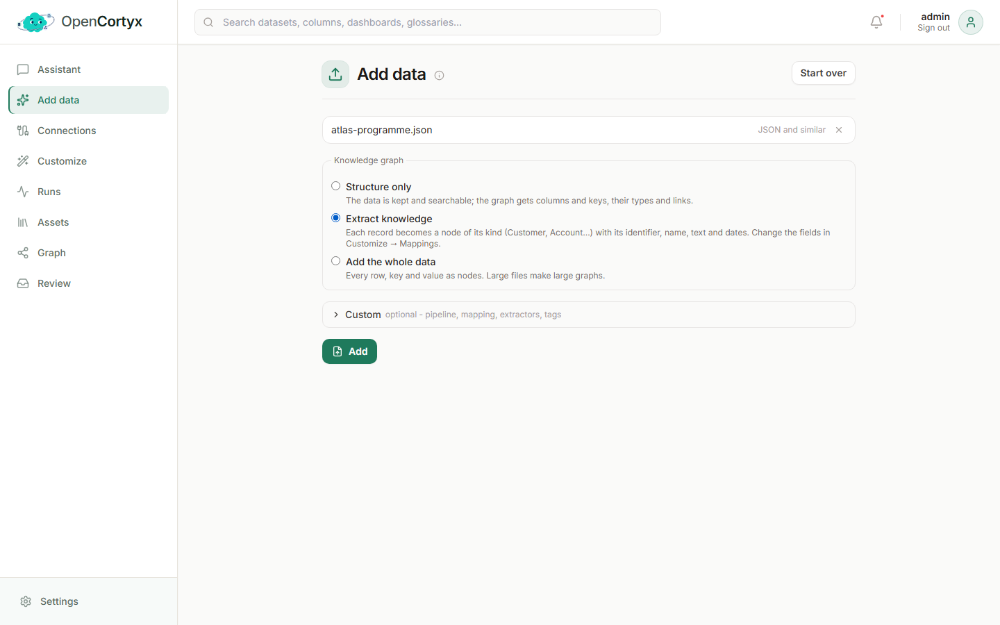
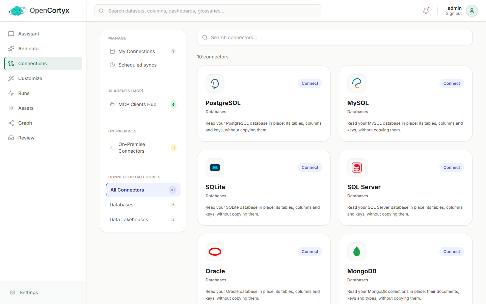
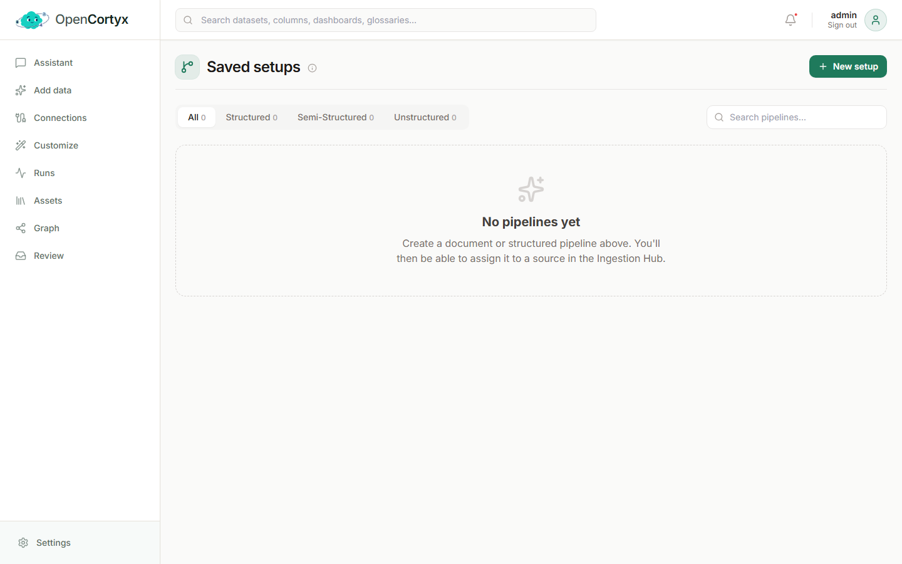
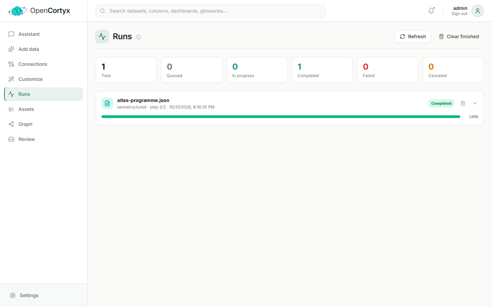

# Integration

Bring data in and decide what it becomes. **Add data** and **Connections** are in the sidebar;
Mappings, Extractors, Saved setups (pipelines) and Scheduled syncs (ingestions) are under
**Customize**, and **Runs** has the sidebar entry of its own.

If you only want to add a file, start with [Add data](#add-data). The other pages are for data you
add again and again: saved connections, scheduled ingestions, and the mappings and pipelines that
read them.

## Add data

Add data is the quickest way in. Drop a file, choose what the graph gets from it, and press **Add**.
Or drop several files at once and add them together.

### How to use it

1. Open **Add data** and drop a file on the page, or click to choose one. Documents, spreadsheets,
   JSON and CSV all work. OpenCortyx works out which kind it is.
2. Under **Knowledge graph**, choose what the graph gets. The data itself is always kept, read
   with SQL and searchable, whichever you pick:
   - **Structure only** (tables, JSON): the columns or keys, their types and the links between
     files, with a description of each column when a model is on. For documents this option is
     **Summary only**: a summary, when AI summaries are on.
   - **Extract knowledge** (tables, JSON): OpenCortyx looks at each column's values and picks the
     ones that carry knowledge: the identifier, the name, text and dates. Each record becomes one
     node of its kind (Customer, Account, Project, Risk…) with those fields, and records that
     refer to each other are linked. Records nested inside others are found too: a project's risks
     inside a programme file become Risks linked to their Project. Change any of it later in the
     [Mapper](#mapper).
   - **Add the whole data**: every row, key and value, or every heading, paragraph and table, as
     nodes. It already holds every record, so it is never combined with Extract knowledge. Large
     files make large graphs.
3. Open **Custom** only if you want more. There you can add **Tags** (the graph groups assets by
   tag), choose a [pipeline](#pipelines) per kind of file, a [mapping](#mapper), and
   [extractors](#custom-extractors) to run over the file once it is in. Each extractor can be given
   the columns or keys (tables, JSON) or the sections (documents) it should read; leave it empty and
   it reads all of it.
4. Press **Add** and wait for the result card. It lists what was created, for example *Found 1
   Programme, 3 Projects, 3 Risks*. Detection runs once the file is in, and its reading appears
   under **Customize > Mappings** a minute or two later.

### Several files at once

Select or drop more than one file. The page lists them, with the same **Knowledge graph** choice
and, under **Custom**, a pipeline for each kind of file in the list. Press **Add N files**: each file
is ingested with the pipeline chosen for its kind, or the default one for its file type, and its
status shows in the list. Every file becomes its own run under [Runs](#runs).

### Good to know

- Nothing is saved or ingested until you press **Add**.
- Fields named `id` or ending in `_id` are kept as ordinary attributes. Each record gets its own
  node, so two files that share an id never overwrite each other. To link records that are the same
  thing, set [Resolution](trust.md#match-the-same-record-across-files-resolution) for their type.
- Adding the exact same file twice is skipped. If its knowledge went missing, the result card
  offers to read it again.

## Connections

A connection is a saved data source: a database, cloud storage, or a folder on the server.
[Ingestions](#ingestion) read from connections.

| Kind | Sources |
|---|---|
| Databases | PostgreSQL, MySQL, Microsoft SQL Server, Oracle, SQLite |
| Object storage | Amazon S3, Google Cloud Storage, Azure Data Lake Storage |
| Local files | a folder on the host, made available with `OPENCORTYX_FILES_ROOT` in `.env` |

### How to use it

1. Open **Connections**. The catalogue lists every connector. Use **Databases** or **Data
   Lakehouses** on the left to narrow it, or search.
2. Press **Connect** on the one you need.
3. Fill in the details. For the credentials, choose where they come from:
   - **Form**: type them in. They are encrypted before they are stored.
   - **Environment variable**: name a variable the server already has.
   - **Azure Key Vault**: read them from a vault, with a managed identity or a service principal.
4. Press **Test Connection**. When it works you can browse the tables or folders it can see.
5. Save. The connection appears under **My Connections**, ready for an ingestion.

### Good to know

- Secrets are never stored in plain text and never included in exports.
- **MCP Clients Hub** lists the AI agents you can connect over MCP. See
  [MCP tools](intelligence.md#mcp-tools).
- **On-Premise Connectors** read files on machines inside your network.

## Ingestion

An ingestion is a saved job you can run again: where to read from, what to read, and which
[pipeline](#pipelines) processes it.

### How to use it

1. Open **Customize > Scheduled syncs** (or **Connections > Scheduled syncs**), press **New sync**
   and give it a name. The short form asks only for the connection and what to read; **More
   options** shows everything below.
2. Choose the **Source**: a saved connection, or **Upload** to pick files (**Pick Files**) or a
   whole folder (**Pick Folder**).
3. Choose the **Classification**. **Auto-detect** sends each file to the pipeline that suits it.
   Use **Force Structured**, **Force Semi-Structured** or **Force Unstructured** to send everything
   one way.
4. Choose a **Pipeline**, or keep the default. With auto-detect you can pick one per kind:
   **Documents**, **Tables**, and **JSON and records**.
5. Choose how often it runs:
   - **On-demand**: only when you press run.
   - **Scheduled**: hourly, daily, weekly or monthly, at the time you set (UTC).
   - **Real-time**: on every sync tick, every 30 seconds by default (`SYNC_TICK_SECONDS`).
6. For folders, turn on **Watch folders** to pick up new files as they arrive, and **Keep folders
   as graph nodes** to keep the folder structure in the graph.
7. Press **Save**. The ingestion appears under **Saved ingestions**. Press **View runs** to follow
   it.

### Good to know

- Every run compares the source with the previous run and processes only what changed. The modes
  differ only in what starts a run.
- A file you add on the Add data page also appears here, as a one-time upload.
- **Supported file types** lists every format and the pipeline each one goes to.

### Supported formats

Each file is routed by its extension (or, without one, by its content) to the pipeline that suits
its shape:

| Route | Formats | Processing |
|---|---|---|
| Documents | `pdf` `docx` `doc` `pptx` `odt` `txt` `md` `markdown` `rst` `html` `htm` `eml` `msg` `log` `tex` `hl7` `csl` | parsed, chunked, embedded, then extracted by the model |
| Semi-structured | `json` `jsonl` `ndjson` `xml` `yaml` `yml` `toml` `rss` `atom` `geojson` `fhir` `har` | walked into nodes and edges, without model calls for the structure |
| Structured | `csv` `tsv` `parquet` `xlsx` `xls` `xlsm` `orc` `feather` `arrow` `avro` | loaded as tables, columns and rows |

The running server reports the same list at `GET /api/v2/ingest/formats`.

## Mapper

A mapping says exactly what a source becomes: which node types, which relationships, and which
fields are kept as attributes. One editor covers JSON, tables and documents.

### How to use it

1. Open **Customize > Mappings**. The list shows every mapping, its kind, the shape of graph it produces and its
   status.
2. Press **Semi-structured**, **Structured** or **Unstructured** to start a new mapping, or click
   an existing one to edit it. A mapping saved from Add data is already here.
3. Load a sample of your data. It appears under **Source sample** (for a document, **Parsed
   document**). For documents you can upload a PDF, Word, PowerPoint or HTML file as well as
   Markdown or text: it is read the way ingestion reads it, so the preview shows its title, its
   sections nested by level, each paragraph, list item and table under its section, and the running
   page headers and footers of every page.
4. Under **Rules**, each node rule turns one path of the sample into one node type. Click a rule to
   edit it on the right:
   - **Node label** is the type it creates, such as `Project`.
   - **Source path** is where it reads from. `[]` means every element of that list.
   - **Attributes** are the fields kept on the node. Click a field to keep or drop it.
5. Add edge rules to connect node types. An edge can join by **This row**, **In context** (the
   nearest enclosing node), **By value** (a value matched against a field of the other type) or
   **By position** (the same index in a sibling list).
6. Press **Run sample** to preview the graph the mapping produces.
7. Press **Save**. Until you save, nothing changes.

### Good to know

- A new source whose [schema signature](discover.md#schema-signatures) matches a mapping is read
  through it automatically.
- A pipeline option decides what happens to a source the mapping does not match: it is read with
  the defaults while **Accept newly detected shapes** is on, and skipped while it is off.
- For JSON, ids are ordinary attributes. Tables keep their primary key, which identifies a row
  within its own table.
- A document preview reads the first 5 pages. See
  [How a document is read](../how-it-works.md#how-a-document-is-read) for the node types it
  produces.
- **Conformance** checks that what an asset produced matches its mapping. **Usage** shows which
  pipelines and ingestions use a mapping before you change it.

## Custom Extractors

Extractors turn what you already have into new nodes, relationships and attributes, for example
the people and organisations named in a document. You define them here, without code.

### How to use it

1. Open **Customize > Extractors**. The three tabs are:
   - **Your extractors**: the ones you created.
   - **Relationships**: rules that connect nodes into typed relationships.
   - **Built-in**: the extractors that ship with OpenCortyx, grouped by what they read (structured
     tables, documents and text, and more).
2. To create one, press **New extractor** and say:
   - which node types it reads (for example `Chunk`),
   - how it works (an AI prompt, code, or a rule),
   - what it produces: the node types, relationships and attributes.

   For people, places, organisations and how they connect, choose **Find with: people, places,
   things and how they connect (the model)**. Your extraction model reads the text and returns each
   named thing with its type, and each relationship a sentence states between two of them, named by
   its verb (`WORKS_AT`, `MET`). Each thing becomes a node of the type the model gave it, linked from
   the text it was found in, and the same name found again is the same node.
3. Preview it on a few sample nodes, then save.
4. Press **Run** on any extractor to run it over the workspace now, or add it as a step in a
   [pipeline](#pipelines) so it runs on every new asset.
5. Press **Edit** to change an extractor, or the bin to delete one of yours.

### Resolution settings

An extractor's **Resolution** section says when two nodes it creates are the same thing: the fields
they are **identified by**, the **Scorer** (exact or similar), and when a match is applied
automatically or sent for review. It is the same setting, per node type, that you find on
[Nodes & Relationships](trust.md#match-the-same-record-across-files-resolution), which works for
every type, including the record types of a JSON mapping.

## Pipelines

A pipeline is the list of steps a source goes through. Design one once and use it for any number
of ingestions.

### How to use it

1. Open **Customize > Saved setups**. OpenCortyx ships a default pipeline for each kind: tables (SQL), JSON and
   documents. Pipelines drafted from Add data appear here too.
2. Press **New Pipeline**, or the pencil on a card to edit one. The copy icon duplicates a pipeline
   so you can change it safely.
3. Step 1, the **reading rule**, is the same for every kind: bind a [mapping](#mapper), or leave it
   empty to read the source with the defaults.
4. Set the two options of the reading rule:

   | Option | Documents | Tables | JSON and other records |
   |---|---|---|---|
   | Accept a newly detected shape automatically | unmatched documents use the defaults | unmatched tables use the defaults | unmatched records use the defaults |
   | Extract only | chunks feed extraction and are not saved | tables and columns, no rows | the structure of one sample record, no values |

5. Add the steps that follow, such as entity and relationship extraction, summaries, topics,
   keywords and claims. Each step works on the output of the one before it.
6. Save, then pick the pipeline when you create an [ingestion](#ingestion).

### Good to know

- Extractors you define under [Custom Extractors](#custom-extractors) can be added as steps.
- The tabs at the top filter by kind: **Structured**, **Semi-Structured** and **Unstructured**.

## Runs

Runs shows every ingestion as it happens, step by step.

### How to use it

1. Open **Runs**. The cards at the top count runs by status: queued, in progress, completed, failed
   and canceled.
2. Each run shows its file, its kind, the step it is on and a progress bar.
3. Click the arrow on a run to see each step. A failed step shows its error.
4. Press **Refresh** to update, or **Clear finished** to remove completed runs from the list. The
   data they ingested stays.
