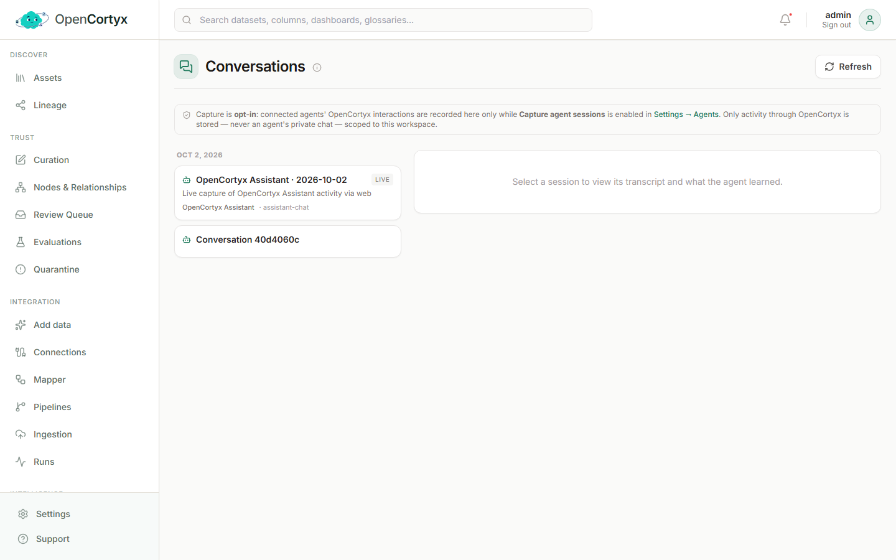

# Intelligence

Ask questions, keep agent memory, and give AI clients access to your knowledge. You find these
pages under **Intelligence** in the dashboard menu.

## AI Assistant

Ask questions in plain language and get answers grounded in your data, with the records each
answer rests on.


### How to use it

1. Open **AI Assistant**, type a question in **Ask a question...** and press **Ask**.
2. Read the answer. Under it, **Sources** lists the records the answer rests on, grouped by the file
   they came from. Each one quotes the passage or record that says it. Click the file name to open
   the asset.
3. Open **Other evidence** to see what else was retrieved but not used in the answer.
4. Open **Retrieval flow** to see how the answer was found, step by step.
5. Keep asking in the same chat, or press **New chat** to start fresh. Past chats are listed on the
   left; search them or rename them there.
6. Press **Save conversation** to turn the chat into context that you and your agents can search
   and cite later.

### Retrieval settings

The panel on the right controls where answers come from:

- **Answer from**: **Your knowledge** (ingested data only), **Our conversations** (saved chats
  only) or **Both**.
- **Evidence blocks**: how many pieces of evidence an answer is built from. More is not always
  better with a small model.
- **Mode**: **Answer (Verified)** writes a checked answer. **Raw Context** shows the retrieved
  evidence without writing an answer, which is handy to see what the model would be given.

### Good to know

- When your data does not support an answer, the assistant **abstains** and says so instead of
  guessing.
- An entity found in many files lists all of them, **ranked for your question**: the first is the
  file where it appears next to what you asked about. **Show more** pages through the rest.
- A record that belongs to no file says where it came from instead: added by a curator, a built-in
  template, or agent memory.
- The badges under an answer show whether it is **Grounded**, its confidence, the relevance score
  and which retrievers found the evidence.

How an answer is produced (retrieval, fusion, reranking, grounding checks) is described in
[How it works](../how-it-works.md#answering-a-question).

### From the API

The same pipeline is available over the API:

```bash
curl -s http://localhost:8000/api/v2/answer \
  -H "X-API-Key: ax_your_key" -H "Content-Type: application/json" \
  -d '{"query": "Who leads the Payments Core Rewrite?"}'
```

Every piece of evidence names where it came from, in the API, the MCP tools, and the `context` an
agent hands to its own model. Each context block carries `asset` and `asset_id` (plus `also_in`
when a shared entity lives in more files), or `origin` when it belongs to no file. Each citation
adds the ranked `sources` with their quoting passages and a `source_count`, and
`GET /api/v2/nodes/{id}/sources` pages through all of them. Citations also carry `supports`:
`true` for the evidence the answer rests on, `false` for the rest.

```json
{"node_id": "…", "type": "Project", "text": "Project Payments Core Rewrite. project_id=PRJ-11 …", "asset": "atlas-programme.json", "asset_id": "…"}
```

## Conversations

Conversations shows what your connected AI agents captured through MCP: their session
transcripts, the decisions made, the facts learned and the preferences expressed.



### How to use it

1. Turn on capture first. Go to **Settings → Agents** and enable **Capture agent sessions** for
   the agents you want. Capture is off until you do.
2. Open **Conversations**. Sessions are listed by day on the left.
3. Click a session to read its transcript and what the agent learned in it.
4. Press **Refresh** to load sessions captured since you opened the page.

### Good to know

- Only what agents do through OpenCortyx is stored, never an agent's private chat.
- Sessions are stored as a graph, so a later session can recall a decision together with the data
  it was about.

## MCP tools

OpenCortyx includes an [MCP](https://modelcontextprotocol.io) server at `http://localhost:8001/mcp`,
so AI clients such as Claude, Cursor and VS Code can search and ask your knowledge directly.

### How to connect a client

1. Create an API key under **Users & Access → Agent API keys**. Pick the role it acts with:
   `viewer` can only read, `editor` can also write.
2. Copy the key. It is shown only once.
3. Connect your client:

   ```bash
   bin/opencortyx connect claude ax_your_key     # Claude Code
   bin/opencortyx connect cursor ax_your_key     # prints the Cursor configuration
   ```

4. Ask your client something about your data. It now calls the tools below.

| Tool | What it does |
|---|---|
| `opencortyx_answer` | A grounded, cited answer to a question, with a trust score |
| `opencortyx_search` | The retrieved context for a query, without writing an answer |
| `opencortyx_search_nodes` | Find graph nodes by text, optionally filtered by type |
| `opencortyx_graph_query` | Search the graph, inspect the results, then traverse or filter |
| `opencortyx_stats` | Counts of nodes and relationships by type |
| `opencortyx_recall` | Relevant past decisions, facts and preferences, for the start of a session |
| `opencortyx_remember` | Store one decision, fact or preference |
| `opencortyx_save_session` | Store the conversation turns of the current session |
| `opencortyx_list_sessions` | List saved sessions |
| `opencortyx_resume` | Reload a saved session with its decisions and facts |
| `opencortyx_feedback` | Rate an answer and optionally correct it |

The server also offers the resources `opencortyx://stats`, `opencortyx://retrievers` and
`opencortyx://collections`, and two prompts: `grounded_qa` (a cited answer to a question) and
`as_of_query` (an answer as the knowledge stood on a given date).

### Good to know

- Over HTTP every call needs an API key, and tools run with the key's role. A `viewer` key cannot
  write.
- Details, transports and client configuration: [apps/mcp/README.md](../../apps/mcp/README.md).
