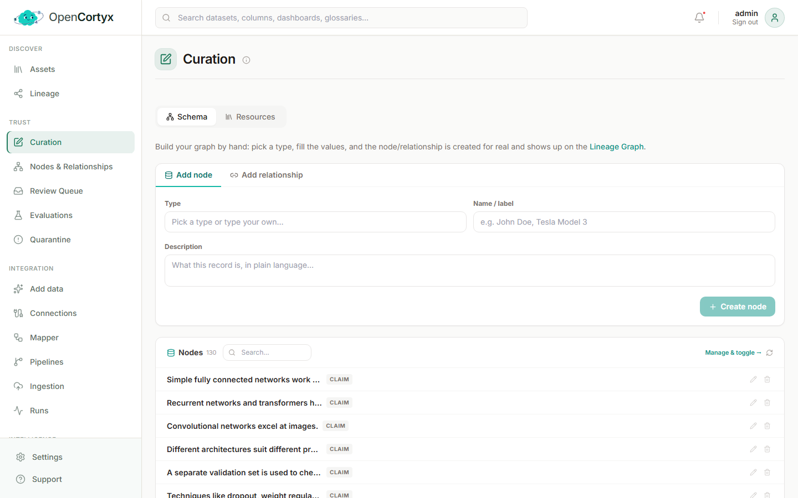
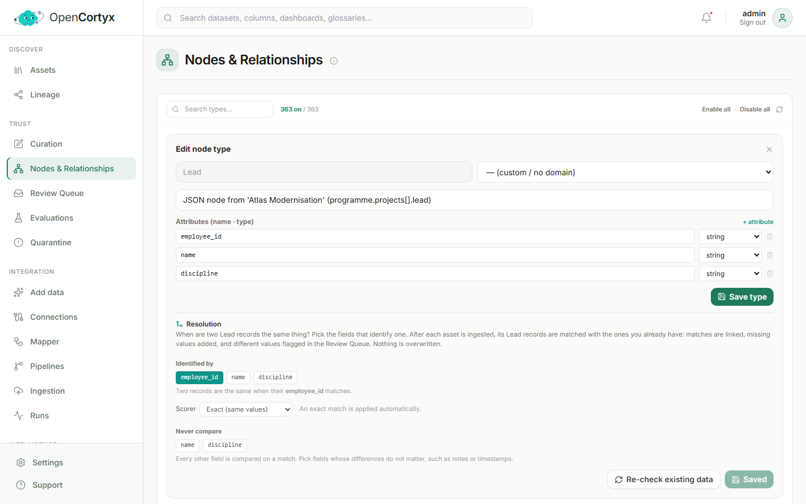
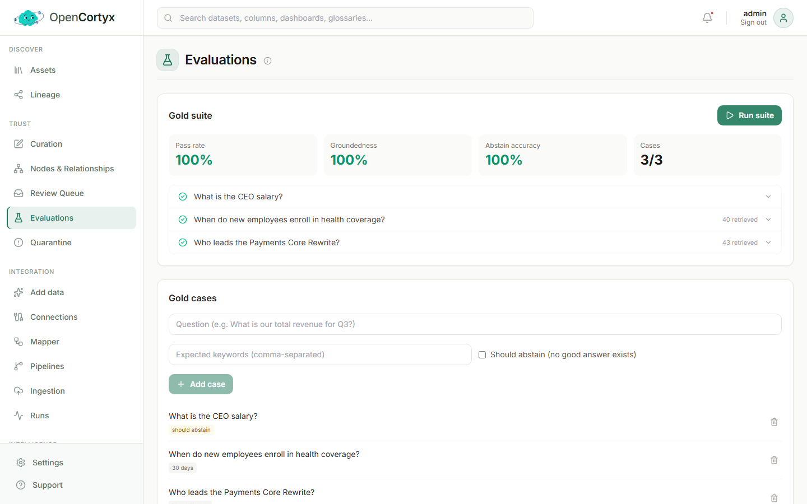
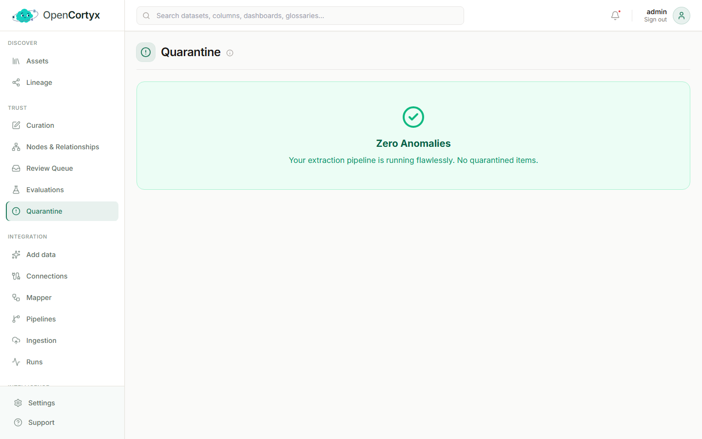

# Trust

Check, correct and govern your knowledge before AI uses it. You find these pages under **Trust** in
the dashboard menu.

## Curation

Curation is where you add knowledge by hand, without a model. Whatever you add here is searchable
straight away and can be used in answers.

### How to use it

The page has two tabs.

**Schema** builds the graph by hand:

1. Under **Add node**, pick a type (or type a new one), give it a name and, if you like, a
   description.
2. Press **Create node**. It appears in the list below and on the Lineage page.
3. To connect two nodes, switch to **Add relationship**, pick both nodes and the relationship type,
   and save.
4. Use the search box above the node list to find a node, then the pencil to edit it or the bin to
   delete it.

**Resources** adds business knowledge:

1. Open **Resources** and pick what you want to add:
   - **Glossary**: a business term and what it means.
   - **Synonyms**: another word for something, such as an acronym, an abbreviation, a former name
     or a common misspelling. A question that uses that word then still finds the right data.
   - **Business rules**: a calculation, policy, data quality or freshness rule, marked **Must**,
     **Should** or **Info**.
   - **Business context**: what your organisation does and the assumptions that apply. Mark an
     entry **Always-on** and it frames every answer.
2. Fill in the form. To tie the entry to specific nodes, attach them, and it is linked to them in
   the graph.
3. Set a status (**Draft**, **Approved** or **Deprecated**) and save.

### Good to know

- Entries are embedded when you save them, so they show up in search and answers at once.
- **Recent edits** lists what changed lately, so you can review what others added.

## Nodes & Relationships

This page shows every node type and relationship type in your workspace, built-in or discovered,
in one place.

### How to use it

1. Type in **Search types...** to find a type.
2. Click the switch on a type to turn it off. A type that is off is hidden from the graph and is not
   extracted any more. Click it again to turn it back on.
3. Click the pencil to edit a type's description. The model reads these descriptions during
   extraction, so a precise description gives better results.
4. Use **Enable all** or **Disable all** to change every type at once.

### Match the same record across files (Resolution)

Each record you ingest becomes its own node, even when another file has a record with the same id.
Resolution is how you tell OpenCortyx when two records are the same thing, for example the same
employee in two files. Nothing is matched until you set it, and it is set per node type.

1. Click the pencil on a node type, for example `Lead`. Its editor opens at the top of the page.
2. Scroll to **Resolution**. The fields listed are the ones real records of this type carry.
3. Under **Identified by**, click the field (or fields) that identify a record, for example
   `employee_id`. Pick two fields, such as `name` and `country`, when only both together are unique.
4. Pick a **Scorer**:
   - **Exact (same values)**: the values must be equal once tidied up. A match is linked
     automatically.
   - **Similar (close spellings)**: "Acme Corp" can match "Acme Corporation". Set **Apply
     automatically at** and **Send for review at**. A match above the first is linked on its own,
     one between the two waits in the [Review Queue](#review-queue).
5. Under **Never compare**, click any field whose differences do not matter, such as notes.
6. Press **Save resolution**. From now on, every new asset is matched after it is ingested.
7. Press **Re-check existing data** to match the records that are already in as well.

When two records match, they are linked as the same thing, values one is missing are added from the
other, and different values are kept on both and flagged in the Review Queue. Nothing is
overwritten. A type with resolution set shows a small link icon next to its name.

### Good to know

- The counter at the top shows how many types are on out of the total.
- A new type needs no database change: properties are stored as JSON.

## Review Queue

The Review Queue is where decisions that need a person wait. Nothing listed here changes your data
until you decide.

### How to use it

Work through the four tabs:

1. **Auto-resolution** shows what the Resolution Engine decided on its own after each asset: which
   records it linked as the same thing, which values it confirmed and which it added. Each line
   shows the reason, the score and the asset that caused it.
2. **Conflicts** holds the cases it was not sure about: two records that might be the same thing,
   two records of the same thing with different values, or two statements that disagree. Read the
   evidence, then **Approve** or **Reject**.
3. **Versions** holds documents that look like a new version of one you already have. The older one
   stays searchable until you decide. **Approve** to mark the new one as its replacement, or
   **Reject** to keep both as separate documents.
4. **Ontology** holds node and relationship types that extraction discovered. **Promote** a type
   to add it to your ontology, or **Reject** it.

### Good to know

- The Resolution Engine only links records of a type once you have said which fields identify that
  type. See [Match the same record across files](#match-the-same-record-across-files-resolution).
  Until then it never guesses.
- When two records disagree, both values are kept and flagged here. Nothing is overwritten.
- Press **Refresh** to load decisions made since you opened the page.

## Evaluations

Evaluations measure how well OpenCortyx answers your own questions. Use them before and after you
change models, mappings or settings.

### How to use it

1. Under **Gold cases**, type a question your data should answer.
2. Add the words a correct answer must contain in **Expected keywords**, separated by commas.
3. If there is no good answer in your data, tick **Should abstain** instead. The case then passes
   only when the assistant declines to answer.
4. Press **Add case**. Repeat for as many questions as you like.
5. Press **Run suite**. Every case goes through the real answer pipeline, one at a time.
6. Read the results. Click a case to see its answer and what was retrieved.

### What the scores mean

- **Pass rate**: the share of cases that passed.
- **Groundedness**: whether the statements in the answers are supported by the retrieved sources.
- **Abstain accuracy**: whether the assistant declined exactly when it should have.

The **Feedback loop** at the bottom collects thumbs up and thumbs down, with corrections, from
dashboard users and from agents through the `opencortyx_feedback` MCP tool.

## Quarantine

Quarantine catches work that did not complete, so nothing is lost silently.

### How to use it

- **Malformed model output.** When a model returns extraction output that cannot be read, it lands
  here instead of being dropped. Fix the JSON in place, or press **Re-run with LLM** to try again.
  Press **Dismiss Anomaly** when you do not need it.
- **Writes that did not land.** When a write to the graph fails, it is held and retried. The page
  counts how many are waiting, how many cannot be written as they stand, and how many recovered.

When both are empty you see **Zero Anomalies**, and there is nothing to do.
