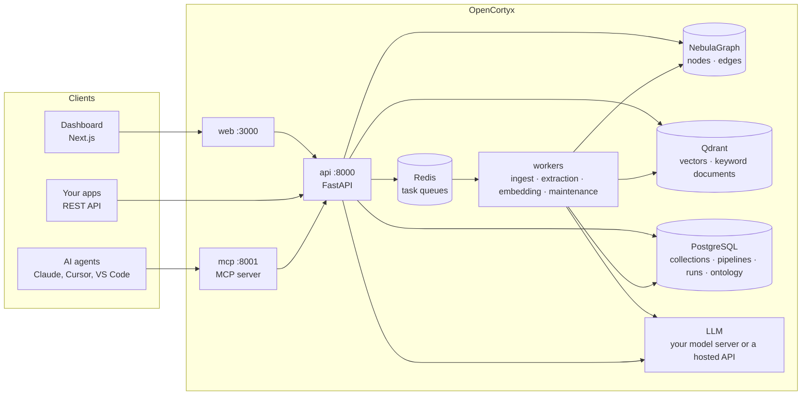
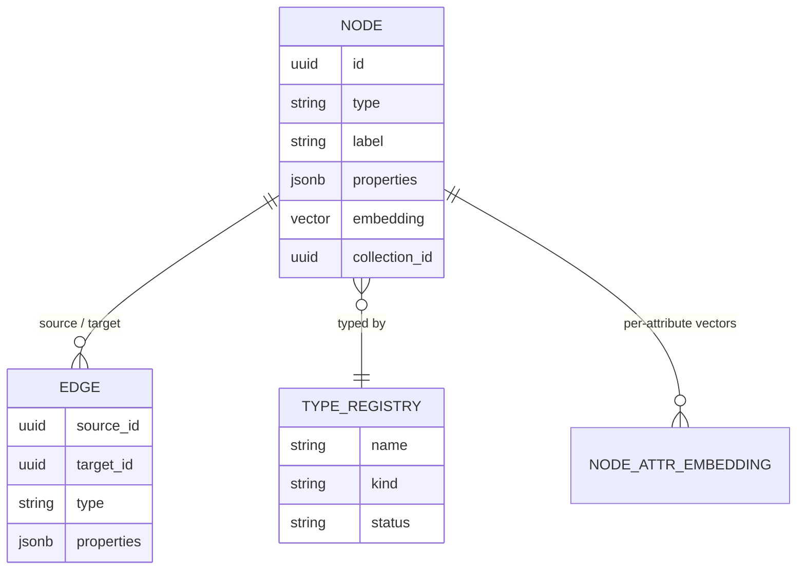
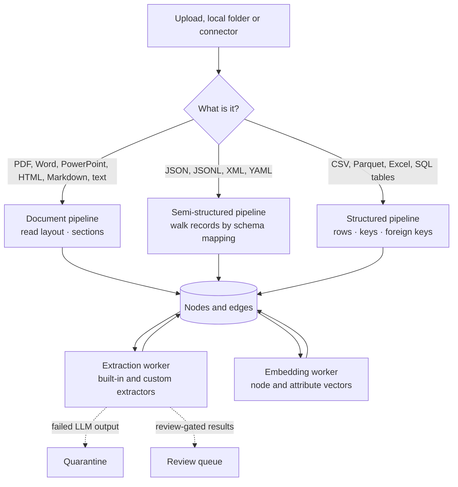
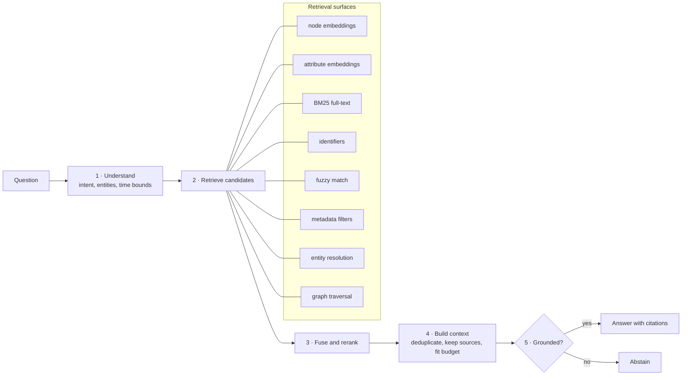
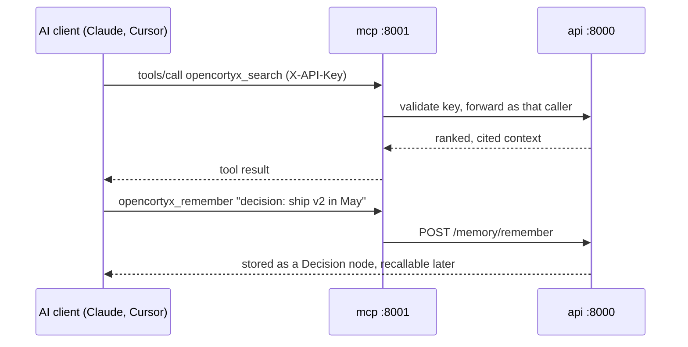

# How OpenCortyx works

OpenCortyx turns documents, files and databases into one governed knowledge graph, then answers
questions and serves AI agents from it with citations.

## The system

| Service | Role |
|---|---|
| `web` | The dashboard. Signs users in and calls the API. |
| `api` | REST API under `/api/v2`: authentication, ingestion requests, retrieval, answers, administration. |
| `mcp` | Exposes OpenCortyx tools to AI agents over the Model Context Protocol. Every call runs as the caller's API key. |
| `worker` | Ingestion: parses uploads and connector data into nodes and edges. |
| `extraction-worker` | Runs the extractors a pipeline names, and relationship extraction. |
| `embedding-worker` | Computes embeddings for search. |
| `maintenance-worker` | Background upkeep of graph statistics. |
| `setup` | Runs once at start-up: prepares the graph and vector stores, then creates and upgrades the database schema. |
| `nebulagraph`, `nebula-metad`, `nebula-storaged` | The graph: nodes and edges. |
| `qdrant` | Vectors and keyword (BM25) documents for search. |
| `postgres` | The control plane: workspaces, users, models, mappings, pipelines, runs, ontology. |
| `redis` | Task queues between the API and workers. |

## Data model

Everything is a **node** or an **edge** in one graph.

- **Nodes** are assets (a document, a table), chunks, rows, entities (people, organisations,
  products), claims, facts, decisions and memories. Properties are JSON, so new shapes need no
  migration.
- **Edges** connect them: a chunk belongs to a document, a claim mentions an entity, a row references
  another row through a foreign key.
- The **type registry** is the ontology: which node and edge types exist and whether they are active.
- Every derived fact keeps its source, so answers can cite where they came from.

## Ingestion

1. **Routing.** The API detects the format and sends it to the matching pipeline.
2. **Mapping.** A [schema mapping](features/integration.md#mapper) decides which parts become nodes,
   edges and attributes. Without one, OpenCortyx walks the structure automatically.
3. **Pipelines.** A [pipeline](features/integration.md#pipelines) is a reusable sequence of stages
   (chunking, then extractors) assigned to sources.
4. **Extraction.** Extractors are declarative templates. Nothing is extracted from documents by
   default: a pipeline names the extractors it runs, built-in or
   [your own](features/integration.md#custom-extractors).
5. **Embedding.** Nodes and their attributes get vectors for semantic search.

### How a document is read

Documents are read by [Docling](https://github.com/docling-project/docling), which looks at the file
itself (its layout, not just its text), and each element it finds becomes a node of its own type:

| Element | Node type | Sits under |
|---|---|---|
| Document title | `Title` | the document |
| Heading | `SectionHeader`, with its `level` | the title or the heading above it |
| Paragraph | `Text` | its section |
| List item | `ListItem` | its section |
| Table | `TableEntity`, with the cells as a grid | its section |
| Figure | `Figure` | its section |
| Caption, footnote, formula, code | `Caption`, `Footnote`, `Formula`, `Code` | its section |
| Running page header and footer | `PageHeader`, `PageFooter`, with the page number | the document |

`CONTAINS` edges make this a tree and `NEXT` edges keep the reading order. A PDF does not record
heading levels, so they are taken from the section numbers ("2.1" sits under "2"), and an
unnumbered heading that opens a numbered document is its title. Word files carry their own levels.
To see how a file reads before ingesting it, upload it in the [Mapper](features/integration.md#mapper).
6. **Accounting.** Every intended write is counted; anything that fails lands in quarantine instead of
   disappearing. Progress is visible under **Runs**.

## Answering a question

1. **Understand.** Classify the question (lookup, semantic, relationship, multi-hop, temporal,
   aggregation) and pick only the retrieval surfaces that help that shape of question.
2. **Retrieve.** Run those surfaces over the same graph.
3. **Fuse and rerank.** Combine ranked lists with reciprocal rank fusion, then rerank with a
   cross-encoder (optional) or the LLM.
4. **Build context.** Collapse representations of the same evidence, keep the source, and pack blocks
   into the model's context window.
5. **Answer.** Generate an answer that cites its sources, verify sentences against the context, and
   abstain when the evidence is not there.

The same pipeline serves the dashboard's **AI Assistant**, `POST /api/v2/answer`, `POST /api/v2/context`
and the MCP tools `opencortyx_answer` and `opencortyx_search`.

## AI agents (MCP)

Agents can search and answer, query the graph, remember decisions and facts, save and resume
sessions, and propose changes that a person approves in the **Review Queue**.

## Security model

- Users sign in to the dashboard; roles are admin, editor and viewer.
- Agents and scripts use API keys that act with a role; keys can be revoked at any time.
- The MCP server requires a key for every client and only accepts the hostnames you allow.
- Services listen on `127.0.0.1` by default; expose them through a TLS reverse proxy.

See [architecture.md](architecture.md) for the full design reference.
